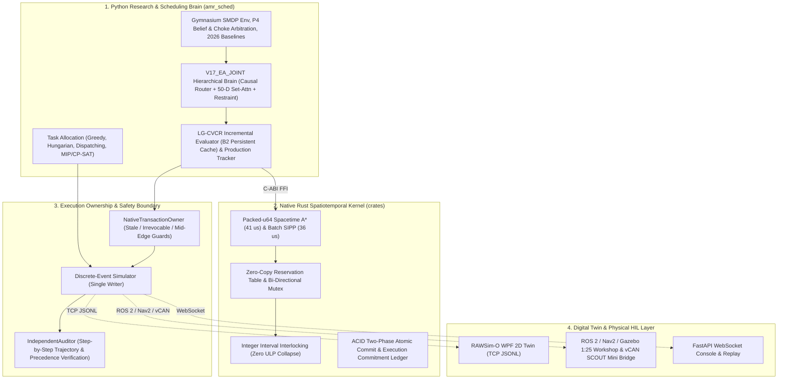
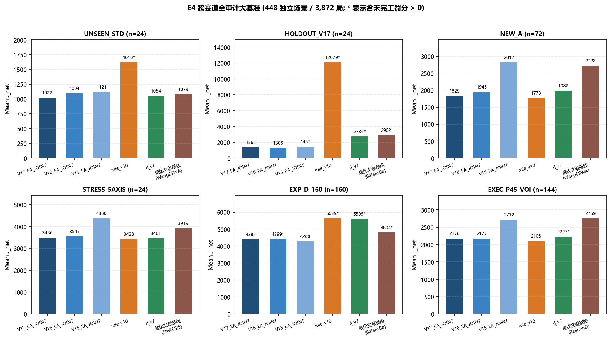
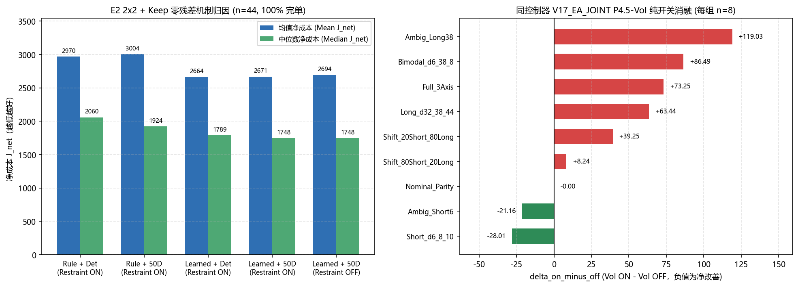
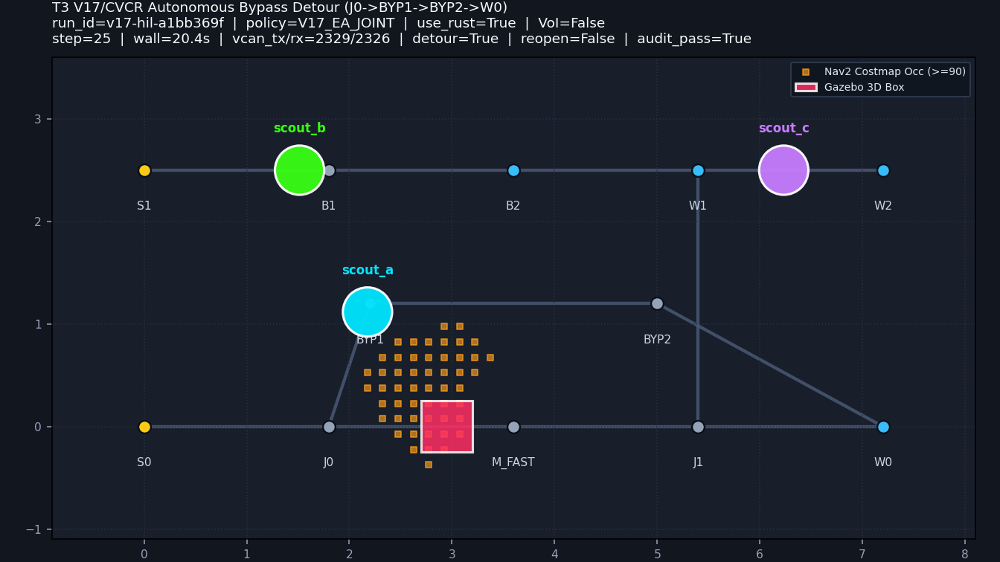

# AMR-Scheduler: Multi-AMR Material Delivery Scheduling & Digital Twin Platform

<div align="center">

[](https://github.com/AmaneSuzuha000/AMR-Scheduler/actions/workflows/ci.yml)
[](https://www.python.org/)
[](https://www.rust-lang.org/)
[](https://docs.ros.org/en/humble/)
[](https://gazebosim.org/)
[](https://dotnet.microsoft.com/)
[](Tests/)
[](LICENSE)

**English** | [简体中文](README_zh.md)

</div>

---

## Overview

**AMR-Scheduler** (`v0.3.0`) is a multi-robot coordination, hierarchical execution-aware rescheduling, and digital twin platform engineered for **discrete-workstation, batch-material, narrow-aisle railway freight car maintenance workshops**.

The platform integrates four synchronized layers:

$$\text{Causal Snapshot} \longrightarrow \text{V17 Hierarchical Brain} \longrightarrow \text{Rust Spatiotemporal Kernel} \longrightarrow \text{Atomic Commit \& Digital Twin}$$



---

## Key Capabilities

### 1. V17 Hierarchical Scheduling Brain (`V17_EA_JOINT`) & Packaged NumPy Inference
- **Strict Causal Snapshot (`NativeSnapshotCapture`)**: Freezes in-flight commitments (`FROZEN_COMMITMENT`), hides unreleased tasks (`hide_future_releases=True`), and prevents mid-edge (`_transit`) mutations.
- **Causal Portfolio Router + 50-D Pairwise Window Ranker (`v17_window_protection.py`)**: Combines a topology-free causal context router (`V15_SOFT`, `V7_CALM`, `V10_GUIDED`) with Set-Attention candidate scoring over 36-D structural + 14-D pairwise payoff features and **Keep-Zero Conservative Regret Restraint**.
- **P4 Chronic Belief & Multi-Hop Choke Arbitration (`p4_belief_choke.py`)**: Estimates persistent corridor blockage hazards online and arbitrates directional choke tokens across single-lane bridges with Safe Haven holding.
- **Event-SMDP Execution Feedback & Closed-Loop Physical Adapter (`v17_event_smdp.py`, `physical_bridge.py`)**: Couples physical travel drift, blockage alarms, and re-routing inside virtual/wall-clock computation budgets.
- **Zero-PyTorch Runtime Deployment**: Packaged pure-NumPy `.npz` inference weights (`amr_sched/checkpoints/`) allow clean CI and edge runtimes to execute trained `lrho`, `v12`–`v17` policies in `< 1 ms` per score step.
- **Gymnasium Environment & 2026 Venue Baselines (`amr_sched/rl/`, `amr_sched/baselines/`)**: Includes masked Dueling DQN / SMDP controllers and reproducible causal adapters for top-venue baselines (`Wu EJOR'26`, `Choi IJCAI'26`, `Ma TII'26`, `Sow JAIR'26`, `Parimi MIT'26`, `Zhang ICRA'26`, `BalansBanditPhan24`, `ReijnenDRALNS24`, `WangESWA24`, `ShiAEI25`).

### 2. High-Performance Rust Native Kernel (`crates/`)
- **`reservation_core`**: Half-open integer `[start, end)` intervals eliminating floating-point ULP drift, enforcing bidirectional single-lane aisle mutex and indexed batch queries.
- **`spacetime_planner`**: Packed `u64` **Spacetime A\*** (`41 us` mean single-agent search, **10.8x** faster than Python) and batch parallel **SIPP** (`36 us` mean).
- **ACID Two-Phase Commit & `ffi_guard!`**: Multi-hop staging transactions and panic-unwinding fences across the C-ABI boundary (`crates/*/src/ffi.rs`).

### 3. Digital Twin, ROS 2 / Nav2 & 1:25 SCOUT Mini HIL
- **1:25 Gazebo Physical Workshop (`assets/`, `simulation/`, `tools/live_bridge/`)**: Models bearing press cells, wheelset disassembly stands, ultrasonic inspection benches, and buffer racks with 5 mm docking convergence and normal-force contact verification.
- **ROS 2 / Nav2 / SocketCAN (`tools/ros2/`, `tools/live_bridge/vcan_gazebo_bridge.py`)**: Translates CVCR route commitments and topological detours into Nav2 corridor constraints, RViz overlays (`amr_v15_digital_twin.rviz`), and CAN 2.0B (`0x421`/`0x211`/`0x221`) frames for AgileX SCOUT Mini (with cross-platform `vcan0` / loopback simulation).
- **C# `RAWSimO.Live` 2D Twin & Web Dashboard**: TCP JSONL streaming (`PROTOCOLS.md`) and FastAPI WebSocket telemetry console (`web/server.py`).

---

## Experimental Highlights

### V17 Grand Benchmark (E4: 6 Tracks, 448 Independent Scenarios, 100% Audited)

Across all 6 blind evaluation suites (`UNSEEN_STD`, `HOLDOUT_V17_FINAL`, `NEW_A`, `STRESS_5AXIS`, `EXP_D_160`, `EXEC_P45_VOI`), **`V17_EA_JOINT`** is the only evaluated policy achieving **100.0% task completion (`TCR = 1.000`)**, **100.0% production completion (`PCR = 1.000`)**, **zero unfinished penalties**, and **448/448 trajectory audit passes**:

| Track (`n`) | `V17_EA_JOINT` Mean $J_{\text{net}}$ (Median) | `V17` TCR / Unf. Penalty | `V16_EA_JOINT` Mean $J_{\text{net}}$ | `rl_v7` Mean $J_{\text{net}}$ | `rule_v10` Mean $J_{\text{net}}$ | Best Literature Baseline ($J_{\text{net}}$) |
| :--- | :---: | :---: | :---: | :---: | :---: | :---: |
| **`UNSEEN_STD`** (`24`) | **1,022.49** (`843.46`) | **1.000 / 0.0** | 1,093.72 | 1,053.72 | 1,618.37 | `WangESWA24` (`1,079.09`) |
| **`HOLDOUT_V17`** (`24`) | 1,364.93 (`1,073.03`) | **1.000 / 0.0** | **1,307.90** | 2,736.36 | 12,078.98 | `BalansBanditPhan24` (`2,901.61`) |
| **`NEW_A`** (`72`) | 1,829.19 (`1,811.24`) | **1.000 / 0.0** | 1,944.76 | 1,982.32 | **1,772.98** | `WangESWA24` (`2,722.34`) |
| **`STRESS_5AXIS`** (`24`) | 3,485.82 (`2,502.56`) | **1.000 / 0.0** | 3,544.55 | 3,460.88 | **3,428.44** | `ShiAEI25` (`3,919.27`) |
| **`EXP_D_160`** (`160`) | 4,385.19 (`4,108.48`) | **1.000 / 0.0** | 4,399.00 (`unf 162.5`) | 5,594.73 | 5,639.22 | `BalansBanditPhan24` (`4,803.69`) |
| **`EXEC_P45_VOI`** (`144`) | 2,177.75 (`2,151.65`) | **1.000 / 0.0** | 2,177.31 | 2,226.90 | **2,107.68** | `ReijnenDRALNS24` (`2,758.71`) |

<p align="center">
  
  
</p>

<p align="center">
  
  
</p>

### Fleet Scaling & Rust Kernel Speedup (62-Node, 144-Edge Workshop, 50 Tasks)

| Fleet Size (AGVs) | Engine | Completed | Makespan (Steps) | Wall Time (s) | Step Latency (ms) | $\le 50\text{ ms}$ Budget | Speedup |
| :---: | :--- | :---: | :---: | :---: | :---: | :---: | :---: |
| **6** | Rust Spacetime A\* | 50 / 50 | 1,571 | 0.051 s | **0.033 ms** | ✅ PASS | **1.57x** |
| **12** | Rust SIPP | 50 / 50 | **1,026** | 0.098 s | 0.095 ms | ✅ PASS | 1.26x |
| **24** | Rust Spacetime A\* | 50 / 50 | **957** | 0.201 s | **0.210 ms** | ✅ PASS | **1.35x** |
| **48** | Rust Spacetime A\* | 50 / 50 | **2,671** | 2.353 s | **0.881 ms** | ✅ PASS | **1.22x** |
| **64** | Rust SIPP | 40 / 50 | 3,500 | 10.818 s | 3.091 ms | ✅ PASS | Saturated ($N > |V|$) |

---

## Quick Start

### Prerequisites
- **Python**: `>= 3.10` (CI verified on `3.11` & `3.12`; local verified on `3.14`)
- **Rust Toolchain**: `cargo` & `rustc` (`>= 1.75`)
- **.NET SDK**: `6.0` (for `RAWSimO.Live` and tests)
- **ROS 2 Humble & Gazebo**: optional (for 3D HIL physics & Nav2 overlay)

### 1. Clone, Install & Build Rust Kernel
```bash
git clone https://github.com/AmaneSuzuha000/AMR-Scheduler.git
cd AMR-Scheduler

# Build native Rust cdylib (reservation_core & spacetime_planner)
cargo build --release --manifest-path crates/Cargo.toml

# Install core Python dependencies (add "[rl]" or gymnasium/torch/ortools for full RL/CP-SAT suites)
pip install -r requirements.txt
pip install -e ".[dev,viz,web,rl]"
```

### 2. Run Scheduling Simulations
```bash
# Python Spacetime A* baseline
python -m amr_sched --tasks 50 --agvs 6 --layout workshop

# Rust-accelerated Spacetime A* and continuous SIPP
python -m amr_sched --tasks 50 --agvs 6 --layout workshop --planner rust_spacetime_astar
python -m amr_sched --tasks 50 --agvs 6 --layout workshop --planner rust_sipp
```

### 3. Run Verification & Test Suites
```bash
# Python suite (2,098 active tests in clean CI checkout + 42 local-evidence skips across 135 files)
python -m pytest -rs

# Rust unit tests (24 tests) and Python-Rust differential fuzzing (7 tests)
cargo test --manifest-path crates/Cargo.toml
python -m pytest -q experiments/rust_transition/

# C# RAWSimO.Live tests (197 tests across 34 files)
dotnet test Tests/RAWSimO.Live.Tests/RAWSimO.Live.Tests.csproj -c Release

# Data manifest integrity, Demo B frame stream, and cross-layer chain checks
python tools/data_manifest.py --check
python tools/verify_demo_b.py
python tools/verify_fleet_chain.py --steps 60
python tools/verify_all_chain.py --fast
```

### 4. Launch Web Dashboard & Live Digital Twin
```bash
# Web console at http://127.0.0.1:8077
python web/server.py

# Single-vehicle chassis TCP bridge for RAWSim-O WPF
python tools/live_bridge/live_bridge.py --mode sim --rate 20 --port 9300
```

---

## Project Structure

```text
AMR-Scheduler/
├── amr_sched/                  # Python scheduling brain, CVCR engine, RL env, and simulator
│   ├── allocation/             # Greedy, Hungarian, dispatching rules, composable allocators
│   ├── baselines/              # Causal 2024–2026 top-venue literature baseline adapters
│   ├── checkpoints/            # Packaged pure-NumPy .npz inference weights (L-RHO, V12–V17)
│   ├── cvcr/                   # Snapshot, B2 evaluator, V12–V17 policies, P4 belief, Owner & Auditor
│   ├── planners/               # Dijkstra, Spacetime A*, Rust A*, Rust SIPP, batch zero-copy FFI
│   ├── rl/                     # Gymnasium SMDP env, action masks, V10/V12/V13 controllers, CUDA helpers
│   ├── viz/                    # Layout, Gantt, corridor heatmaps, trajectories, animations
│   ├── rust_reservation.py     # Zero-copy C-ABI bindings for reservation_core
│   └── simulation.py           # Authoritative single-writer discrete-event simulator
├── crates/                     # Native Rust Cargo workspace (cdylib + unit tests)
│   ├── reservation_core/       # Integer interval table, bidirectional mutex, atomic tx, ledger
│   └── spacetime_planner/      # Packed-u64 Spacetime A* & batch continuous SIPP with ffi_guard!
├── RAWSimO.Live/               # C# (.NET 6) live TCP JSONL protocol consumer & topology tracker
├── RAWSimO.Visualization/      # C# WPF 2D visualizer & live monitoring UI
├── tools/
│   ├── live_bridge/            # Gazebo/Nav2/SCOUT v2 CAN hardware bridges & corridor projector
│   ├── ros2/                   # ROS 2 Humble guard nodes, SCOUT URDF/meshes, RViz/Nav2 configs
│   ├── wheelset_scene/         # 1:25 railway wheelset workshop builder & verification suite
│   ├── data_manifest.py        # SHA-256 + summary verification for results/*.csv (34 CSVs)
│   ├── verify_all_chain.py     # Cross-layer end-to-end verification runner
│   └── ...                     # Fleet stream server, mock bridge, differential benchmark runners
├── experiments/                # Scaling/matrix benchmarks, Rust differential tests, plotting scripts
├── results/                    # 34 verified CSV datasets, MANIFEST.json, figures/, replay.html
├── docs/architecture/          # System architecture spec and ADRs (001 FFI, 002 Tx/Auditor)
├── web/                        # FastAPI WebSocket monitoring & replay console
└── Tests/                      # 135 Python test files + 34 C# xUnit test files (RAWSimO.Live.Tests)
```

---

## Documentation & License

- **Architecture & Decisions**: [Architecture Spec](docs/architecture/ARCHITECTURE.md), [ADR 001 (Rust cdylib FFI)](docs/architecture/decisions/001_cdylib_ctypes_architecture.md), [ADR 002 (Transaction & Auditor)](docs/architecture/decisions/002_transaction_auditor_data_flow.md)
- **Wire Protocols & History**: [PROTOCOLS.md](PROTOCOLS.md), [CHANGELOG.md](CHANGELOG.md), [CONTRIBUTING.md](CONTRIBUTING.md)
- **License**: Original code (`amr_sched/`, `crates/`, `RAWSimO.Live/`, `experiments/`, `tools/`, `Tests/`, `web/`) is licensed under **GPL-3.0**. Upstream RAWSim-O components retain their original licenses. See [LICENSE](LICENSE) and [ThirdPartyLicenses.txt](ThirdPartyLicenses.txt).
