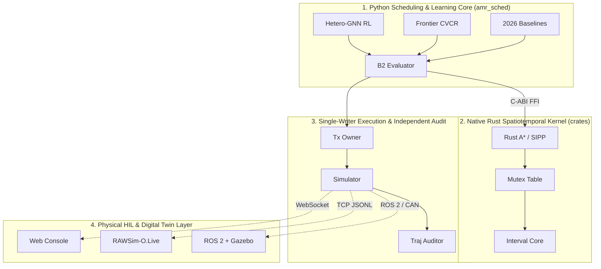

# AMR-Scheduler: Execution-Aware Spatiotemporal Reservation & Heterogeneous-Graph Joint Scheduling Platform

<div align="center">

[](https://github.com/AmaneSuzuha000/AMR-Scheduler/actions/workflows/ci.yml)
[](https://www.python.org/)
[](https://www.rust-lang.org/)
[](https://docs.ros.org/en/humble/)
[](https://gazebosim.org/)
[](https://dotnet.microsoft.com/)
[](LICENSE)

**English** | [简体中文](README_zh.md)

</div>

---

## Overview

**AMR-Scheduler** (`v1.0.0`) is an open-source research and digital-twin platform for **execution-aware multi-AMR material delivery and kitting operation rescheduling** in discrete-workstation, narrow-aisle railway maintenance workshops.

The platform couples four synchronized layers in a closed loop:

$$\text{Causal Snapshot} \longrightarrow \text{Heterogeneous-Graph Joint Constructor + CVCR Brain} \longrightarrow \text{Rust Spatiotemporal Kernel} \longrightarrow \text{Atomic Commit + ROS 2 / Gazebo Digital Twin}$$



---

## Key Contributions & Capabilities

### 1. Heterogeneous-Graph Critical-Chain Joint Constructor & Execution-Aware CVCR (`amr_sched/`)
- **Can–Should Commitment Revision Framework (`NativeSnapshotCapture`, `classify_commitments`)**:
  - **`Can` (Feasible Revision Subspace)**: Freezes irrevocable cargo custody (`PICKED`, `LOADING`, `UNLOADING`, and mid-edge `_transit` in `FROZEN_COMMITMENT`), masks unreleased future tasks (`hide_future_releases=True`), and exposes causal execution feedback (`ExecutionFeedbackPacket`).
  - **`Should` (Counterfactual Long-Horizon Revision Value)**: Evaluates whether revising an incumbent task/bay/crew commitment yields sufficient downstream kitting-DAG and tardiness reduction to outweigh switching churn ($15\cdot\Delta C$) and cascade amplification risk.
- **Heterogeneous-Graph Critical-Chain Joint Constructor (`v19_hetero_graph.py`, `v19_hetero_constructor.py`)**:
  - Encodes `5` domain entity node types (`Operation [12-D]`, `Task [12-D]`, `AMR [10-D]`, `Bay [8-D]`, `Crew [4-D]`) and relational edge/attribute tensors (`op_dag_adj [3-ch]`, `task_to_op`, `op_bay_feats [4-D]`, `op_crew_mask`, `task_agv_feats [8-D]`, and corridor congestion/detour attributes `bay_detour_norm`).
  - Runs 2-layer bidirectional heterogeneous message passing (`encode_entities`: `op_dag_msg`, `kit_task_to_op`, `kit_op_to_task`, `op_bay_mha`, `op_crew_mha`, `task_agv_mha`) followed by 4 coupled decoding heads: workstation bay & crew selection (`A2`: `bay_logits`, `crew_logits`), critical-chain task focus ordering (`A1`: `task_focus_logits`), sequential AMR pointer assignment conditioned on selected bay (`sel_bay_proj`) and cumulative fleet load (`agv_dyn_proj`) (`A3`), and queue insertion priority sequencing (`A4`: `a4_seq_scores`).
  - Trained via multi-expert B2-evaluated Behavior Cloning (`experiments/train_v19_bc.py`) followed by KL-anchored closed-loop SMDP PPO (`experiments/train_v19_rl.py`, `reward_mode="net_obj"`), and exported to pure-NumPy `.npz` weights with `< 1e-5` parity against PyTorch for zero-PyTorch ROS 2 deployment.
- **State-Conditioned Adaptive Cross-Domain Coupling (`experiments/run_v19_exp06_adaptive_coupling.py`)**: Dynamically modulates joint vs. staged decision coupling from instantaneous 6-D state coupling features $\phi(s_t) \in \mathbb{R}^6$ (kitting bottleneck intensity, DAG density, window cliff urgency, detour dispersion, fleet delay, and task concurrency) without static topology labels.
- **Execution-Aware Frontier Synthesis & Chronic Choke Arbitration (`v18_frontier_synthesis.py`, `v17_window_protection.py`, `p4_belief_choke.py`)**: Combines pairwise resource-window protection, non-stationary corridor blockage survival estimation (`CVaR`), and directional single-lane bridge arbitration.
- **Unified Policy Registry & 2024–2026 Baselines (`amr_sched/baselines/`)**: Provides plug-and-play discrete and physical (`PhysicalCVCRCoordinator`) adapters for `Wu et al. (EJOR 2026)`, `Choi et al. (IJCAI 2026 PGMPO)`, `Ma & Zhou (IEEE TII 2026)`, `Hirayama et al. (IEEE RA-L 2026 DetourDelta)`, `Jia Li et al. (COR 2026 SPGA)`, `Zhang et al. (ICRA 2026)`, `Sow et al. (JAIR 2026)`, `Parimi & Williams (MIT 2026)`, and `Cai et al. (IJCAI 2025 BALANS)`, plus an independent 3D warehouse order-picking reproduction (`experiments/ejor26_warehouse_repro/`).

### 2. High-Performance Rust Spatiotemporal Kernel (`crates/`)
- **`reservation_core`**: Half-open integer `[start, end)` interval algebra eliminating floating-point ULP drift, enforcing bidirectional single-lane mutex and ACID two-phase reservation transactions.
- **`spacetime_planner`**: Packed-`u64` **Spacetime A\*** (`41 us` mean single-agent search, **10.8x** faster than Python) and batch parallel **SIPP** (`36 us` mean) guarded across the C-ABI boundary by `ffi_guard!`.

### 3. Dual-Layer Physical ROS 2 / Nav2 / Gazebo Workshop & Digital Twin (`tools/`, `RAWSimO.Live/`)
- **Two Full-Scale Railway Maintenance Workshop Tracks**:
  - **Track 1 (`rail_freight_workshop_v1`)**: 62-node, 144-edge railway freight car maintenance shop with 6 AMRs and multi-stage bogie/wheelset/brake/coupler kitting operations.
  - **Track 2 (`wheelset_workshop_v2`)**: 50-node metric 1:25 railway wheelset maintenance shop with 3 AMRs, physical press/inspection/teardown cells, AMCL/EKF localization, DWB/RotationShim Nav2 control, and `amr_gazebo_guard` C++ safety watchdogs.

---

## Experimental Highlights

### 1. Holdout Benchmark & Adaptive Cross-Domain Coupling (120 Unseen Episodes, Single-Worker Wall-Clock)

| Policy / Variant | Description | Audit Pass | 100%-OK Eps | Task Comp | Prod Comp | Mean `net_obj` ↓ | Mean `cmax` ↓ | Mean Tardiness ↓ | Track 1 (`62`-Node) `net_obj` ↓ |
| :--- | :--- | :---: | :---: | :---: | :---: | :---: | :---: | :---: | :---: |
| **`V19_ADAPTIVE_BANDIT`** | State-Conditioned Contextual Bandit over $\phi(s_t) \in \mathbb{R}^6$ (`59%` Full / `41%` Staged) | **100.0%** | **119/120** | **99.93%** | **99.90%** | **5637.77 (#1)** | 484.6 | **2350.5 (#1)** | 5086.58 |
| **`V19_STAGED_RL`** | Disjoint Staged Ablation (Production → Transport) + SMDP PPO | **100.0%** | 118/120 | 99.83% | **99.90%** | 5974.11 | 499.4 | 2481.0 | 5507.17 |
| **`V19_ADAPTIVE_RULE`** | Instantaneous State Coupling Threshold Gate ($C(\phi(s_t)) \ge \theta_c$) | **100.0%** | 118/120 | 99.69% | 99.22% | 5978.48 | **478.2 (#1)** | 2373.3 | 5743.71 |
| **`V19_HETERO_RL`** | Full Hetero-Graph Joint Constructor + Closed-Loop SMDP PPO | **100.0%** | 118/120 | 99.76% | 99.43% | 6001.36 | 479.4 | 2421.1 | **5085.62 (#1 Fixed)** |
| **`rule_v10`** | Churn-Calibrated Multi-Expert Rule Portfolio | **100.0%** | 117/120 | 99.75% | 99.48% | 6034.34 | 497.9 | 2516.5 | 6805.22 |
| **`V18_EA_JOINT`** | Execution-Aware Frontier Synthesis + Window Protection | **100.0%** | 114/120 | 99.52% | 98.85% | 6221.95 | 484.9 | 2500.8 | 6292.42 |
| **`IJCAI26_PGMPO`** | Choi et al. (*IJCAI* 2026) Bit-Conditioned Dual-Attention PGMPO | **100.0%** | 115/120 | 99.37% | 98.50% | 6484.58 | 493.3 | 2521.6 | 6910.19 |
| **`V19_NO_PROD_COMM`** | Masked Production & Commitment Channels Ablation + SMDP PPO | **100.0%** | 116/120 | 98.95% | 98.33% | 7034.51 | 496.1 | 2511.0 | 5567.71 |
| **`V19_HETERO_BC`** | Multi-Expert B2 Behavior Cloning (Without Closed-Loop RL) | **100.0%** | 115/120 | 98.45% | 98.18% | 7407.27 | 506.2 | 2610.1 | 6038.99 |
| **`EJOR26_Wu_GRU_Attn`** | Wu et al. (*EJOR* 2026) GRU Pointer-Attention + Proximity | **100.0%** | 116/120 | 98.83% | 97.68% | 7988.12 | 506.2 | 2988.5 | 7420.09 |
| **`RAL26_DetourDelta`** | Hirayama et al. (*IEEE RA-L* 2026) Detour-Delta Online MAPD | **100.0%** | 115/120 | 98.74% | 98.74% | 8048.61 | 561.5 | 3257.8 | 7462.83 |

### 2. Causal Cost Attribution, Coupling Gradient (`C0` → `C3`), & Orthogonal Mechanism Ablations (`EXP-01`–`EXP-05`)

- **Conditional 100%-Completed Attribution (`EXP-02`)**:
  - Across the **117 / 120 unseen episodes (97.5%)** where both `V19_HETERO_RL` (Full) and `V19_STAGED_RL` (Staged) complete 100% of tasks and operations, **`V19_HETERO_RL` achieves `mean_net_obj = 5431.53` vs `V19_STAGED_RL = 5704.10` (`-272.58` / `-4.78%` net advantage)**, and across the **113 / 120 completed intersection** with `V19_HETERO_BC`, **`V19_HETERO_RL` outperforms BC by `-98.03` (`66` wins vs `47` losses)** in pure scheduling efficiency ($H_1$) on top of reducing unfinished failure penalties ($H_2$) by **`-991.67` (`70.5%` of total gain)**.
- **Controlled Production–Transport Coupling Gradient (`EXP-04`, Fixed 62-Node Network, 6 AMRs, 8 Tasks, 6 Ops)**:
  - In weak coupling (`C0_Weak`, independent single-task operations), `Staged` (`4035.34`) outperforms `Full` (`9711.53`); as soon as shared bay/crew contention (`C1_Moderate`), multi-task kitting + 3-stage precedence DAG (`C2_Strong`), or dynamic corridor blockage (`C3_Extreme`) enters, **`Full` outperforms `Staged` across all coupled regimes (`-26.21%` in `C1`, `-20.17%` in `C2`, `-1.62%` in `C3`)**.
- **6-Way Orthogonal Single-Factor Mechanism Ablation (`EXP-05`, Track 1 & Track 2 Workshops)**:
  - Removing ONLY encoder-level `Op <-> Task` cross-domain message passing (`no_cross_edge_msg`, keeping all input features intact) degrades `mean_net_obj` by **`+45.86%`** (`9911.00 → 14456.45`); masking ONLY kitting bottleneck features (`no_kit_features`) degrades by **`+43.70%`**; disabling ONLY `A4` queue sequencing (`no_a4_seq`) degrades by **`+18.84%`**; removing ONLY operation DAG edges (`no_op_dag`) degrades by **`+16.12%`**; masking ONLY commitment tier features (`no_commit_features`) degrades by **`+11.12%`**; whereas disabling decoder-level hard `A2 Bay -> A3 AMR` projection (`no_a3_bay_cond`) improves by **`-2.18%`** (`9695.28`), pinpointing decoder-level bay-to-AMR conditioning as the source of cascade error amplification.

### 3. Unified-Objective 5-Seed Dual-Layer Discrete (Layer A) vs Physical (Layer B) Reconciliation (`EXP-07`)

Under the strictly unified objective $J_{\mathrm{unified}} = C_{\max} + 2T_{\mathrm{task}} + 2T_{\mathrm{op}} + 5000U_{\mathrm{task}} + 3000U_{\mathrm{op}} + 15C + 0.05M$ across `5 matched seeds (101..505) × 6 policies = 30` paired runs per track:
- **Track 1 (`62` nodes, `6` AMRs)**: Unified objective Spearman rank correlation **$\rho = 0.8857$** (Kendall $\tau = 0.7333$, Makespan $\rho = 1.0000$), 100% trajectory audit pass, `V19_HETERO_RL` physical coordination latency `p95 = 7.58 ms`, `p99 = 7.89 ms < 35 ms`.
- **Track 2 (`50` nodes, `3` AMRs)**: Unified objective Spearman rank correlation **$\rho = 0.7714$** (Kendall $\tau = 0.6000$, Makespan $\rho = 0.7701$), 100% trajectory audit pass, `V19_HETERO_RL` achieves **zero rank shift (`Rank 3.0` in Layer A and `Rank 3.0` in Layer B)** while outperforming `V18_EA_JOINT` by **`-17.1%`** and `rule_v10` by **`-31.5%`** in Layer B physical execution (`p95 = 15.37 ms`, `p99 = 17.38 ms < 35 ms`).

<p align="center">
  
  
</p>

---

## Quick Start

### 1. Clone, Install & Build Rust Kernel
```bash
git clone https://github.com/AmaneSuzuha000/AMR-Scheduler.git
cd AMR-Scheduler

# Build native Rust cdylib (reservation_core & spacetime_planner)
cargo build --release --manifest-path crates/Cargo.toml

# Install Python package and dependencies
pip install -r requirements.txt
pip install -e ".[dev,viz,web,rl]"
```

### 2. Run Simulations, Training & Scientific Mechanism Benchmarks
```bash
# Run discrete-event workshop simulation with Rust Spacetime A* or continuous SIPP
python -m amr_sched --tasks 50 --agvs 6 --layout workshop --planner rust_spacetime_astar
python -m amr_sched --tasks 50 --agvs 6 --layout workshop --planner rust_sipp

# Re-train or evaluate V19 Behavior Cloning (BC) and closed-loop SMDP PPO
python -B experiments/train_v19_bc.py
python -B experiments/train_v19_rl.py

# Run EXP-01..06 scientific audit, C0-C3 coupling gradient, orthogonal ablations & adaptive coupling
python -B experiments/run_v19_exp01_02_03_audit.py
python -B experiments/run_v19_exp04_coupling_gradient.py
python -B experiments/run_v19_exp05_orthogonal_ablations.py
python -B experiments/run_v19_exp06_adaptive_coupling.py

# Run unified-objective multi-seed dual-layer discrete (Layer A) vs physical (Layer B) reconciliation
python -B experiments/run_dual_layer_reconciliation.py --multi-seed

# Run 62-node 4-axis workshop scaling benchmark & EJOR 2026 3D warehouse reproduction
python -B experiments/run_workshop_scaling_4axis.py
python -B experiments/ejor26_warehouse_repro/run_ejor26_repro.py --quick
```

### 3. Run Verification & Test Suites
```bash
# Python test suite
python -m pytest -q

# Rust unit tests (24 tests) and Python-Rust differential fuzzing
cargo test --manifest-path crates/Cargo.toml
python -m pytest -q experiments/rust_transition/

# C# RAWSimO.Live tests
dotnet test Tests/RAWSimO.Live.Tests/RAWSimO.Live.Tests.csproj -c Release

# Dataset manifest and end-to-end chain checks
python tools/data_manifest.py --check
python tools/verify_demo_b.py
python tools/verify_fleet_chain.py --steps 60
```

---

## Project Structure

```text
AMR-Scheduler/
├── amr_sched/                  # Python scheduling brain, CVCR engine, RL env, and simulator
│   ├── allocation/             # Greedy, Hungarian, dispatching rules, composable allocators
│   ├── baselines/              # Unified policy registry, pure-NumPy backends & 2024–2026 baselines
│   ├── checkpoints/            # Packaged inference weights (.npz / .pt)
│   ├── cvcr/                   # Causal snapshot, B2 evaluator, frontier synthesis, P4 belief, Owner & Auditor
│   ├── planners/               # Dijkstra, Spacetime A*, Rust A*, Rust SIPP, batch zero-copy FFI
│   ├── rl/                     # Heterogeneous-graph joint constructor, Gymnasium SMDP env & controllers
│   ├── viz/                    # Layout, Gantt, corridor heatmaps, trajectories, animations
│   ├── rust_reservation.py     # Zero-copy C-ABI bindings for reservation_core
│   └── simulation.py           # Authoritative single-writer discrete-event simulator
├── crates/                     # Native Rust Cargo workspace (cdylib + unit tests)
│   ├── reservation_core/       # Integer interval table, bidirectional mutex, atomic tx, ledger
│   └── spacetime_planner/      # Packed-u64 Spacetime A* & batch continuous SIPP with ffi_guard!
├── RAWSimO.Live/               # C# (.NET 6) live TCP JSONL protocol consumer & topology tracker
├── RAWSimO.Visualization/      # C# WPF 2D visualizer & live monitoring UI
├── tools/
│   ├── benchmarks/             # Multi-track workshop algorithm comparison suite
│   ├── live_bridge/            # Gazebo/Nav2/SCOUT CAN bridges, fleet runtime & corridor projector
│   ├── ros2/                   # ROS 2 Humble guard nodes, SCOUT URDF/meshes, RViz/Nav2 configs
│   └── wheelset_scene/         # 1:25 railway wheelset workshop builder & full-chain ROS 2 runner
├── experiments/                # Dual-layer reconciliation, 4-axis scaling, 3D warehouse repro & analysis
├── results/                    # 34 verified CSV datasets, MANIFEST.json, figures/, replay.html
├── docs/architecture/          # System architecture specification and ADRs
├── web/                        # FastAPI WebSocket monitoring & replay console
└── Tests/                      # Python pytest suites + C# xUnit test suites (RAWSimO.Live.Tests)
```

---

## Documentation & License

- **Architecture & Decisions**: [Architecture Spec](docs/architecture/ARCHITECTURE.md), [ADR 001 (Rust cdylib FFI)](docs/architecture/decisions/001_cdylib_ctypes_architecture.md), [ADR 002 (Transaction & Auditor)](docs/architecture/decisions/002_transaction_auditor_data_flow.md)
- **Wire Protocols & History**: [PROTOCOLS.md](PROTOCOLS.md), [CHANGELOG.md](CHANGELOG.md), [CONTRIBUTING.md](CONTRIBUTING.md)
- **License**: Original code is licensed under **GPL-3.0**. Upstream RAWSim-O components retain their original licenses. See [LICENSE](LICENSE) and [ThirdPartyLicenses.txt](ThirdPartyLicenses.txt).
