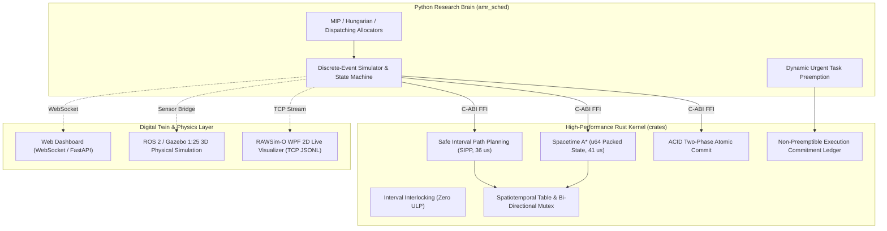

# AMR-Scheduler: Multi-AMR Material Delivery Scheduling Platform for Railway Maintenance Workshops

<div align="center">

[](https://github.com/AmaneSuzuha000/AMR-Scheduler/actions/workflows/ci.yml)
[](https://www.python.org/)
[](https://www.rust-lang.org/)
[](https://docs.ros.org/en/humble/)
[](https://gazebosim.org/)
[](https://dotnet.microsoft.com/)
[](Tests/)
[](LICENSE)

**English** | [简体中文](README_zh.md)

</div>

---

### Overview

**AMR-Scheduler** is a high-performance multi-robot coordination and digital twin research platform specifically engineered for **discrete-workstation, batch-material, narrow-aisle railway freight car maintenance workshops**.

The system couples a high-level Python decision brain with an ultra-fast compiled Rust spatiotemporal reservation kernel, a 2D WPF digital twin (RAWSim-O live link), and a 1:25 scale Gazebo 3D physical simulation environment. It implements the complete decision hierarchy:

$$\text{Task Allocation} \longrightarrow \text{Spatiotemporal Path Planning} \longrightarrow \text{Conflict Resolution} \longrightarrow \text{Dynamic Rescheduling}$$



---

### Key Capabilities & Highlights

1. **High-Performance Rust Native Kernel**:
   - **`reservation_core`**: Integer half-open interval `[start, end)` arithmetic eliminating floating-point ULP collapse. Enforces bidirectional single-lane corridor mutual exclusion and physical sensor pinning.
   - **`spacetime_planner`**:
     - **Spacetime A\***: Packed `u64` state representation with precomputed reverse-Dijkstra heuristics. Achieves **41 μs** average single-agent search time (**10.8x faster** than pure Python).
     - **SIPP (Safe Interval Path Planning)**: Continuous safe-interval jumping delivering $\mathcal{O}(1)$ step transitions over long wait obstacles (**36 μs** average search latency).
   - **Atomic Commit Transactions (`ReservationTransaction`)**: Multi-hop trajectory ACID two-phase staging and atomic commit. Eliminates orphaned reservations on unexpected path contention.
   - **Execution Commitment Ledger (`ExecutionCommitmentLedger`)**: Tracks firm in-flight vehicle commitments, preventing dynamic rescheduling from revoking active aisle rights.

2. **Rigorous Fleet Scaling & Hard Real-Time Latency**:
   - Comprehensive benchmarks across **6, 12, 16, 24, 32, 48, and 64 AMRs** on a realistic 62-node, 144-edge railway maintenance network.
   - **100% compliant with the $\le 50\text{ ms}$ industrial fieldbus real-time decision budget** (online latency ranges from **0.033 ms to 3.091 ms/step**, offering a 16x~1500x safety margin).
   - Discovered the **24-AMR optimal fleet sweet spot** (39.1% makespan reduction) and the **64-AMR physical saturation limit** ($N_{AGV} > |V|$).

3. **3D Physical Closed-Loop & 5mm Precision Docking**:
   - 1:25 scale realistic wheelset maintenance workshop in Gazebo with bearing press cells, disassembly stations, ultrasonic inspection stands, and buffer gantries.
   - Dual-vehicle physical cold-boot closed loop: 5mm terminal circular convergence, 19.42 N normal contact force receipts, and zero watchdog timeouts.

4. **Multi-Platform Digital Twin & Live Stream**:
   - Real-time TCP stream broadcasting vehicle poses, trail histories, and reservation claims to C# RAWSim-O WPF visualizer.
   - Interactive browser-based control console with WebSocket telemetry.

### Digital Twins & Workshop Layout

<p align="center">
  
  
</p>

---

### Performance Benchmark

Results evaluated on the 62-node, 144-edge realistic workshop layout under 50-task industrial loading:

| Fleet Size (AGVs) | Engine | Completed Tasks | Makespan (Steps) | Wall Time (s) | Step Latency (ms) | $\le 50\text{ms}$ Real-Time Budget | End-to-End Speedup |
| :---: | :--- | :---: | :---: | :---: | :---: | :---: | :---: |
| **6** | Python Spacetime A* | 50 / 50 | 1,571 | 0.080 s | 0.051 ms | ✅ **PASS** | 1.00x |
| **6** | **Rust Spacetime A\*** | 50 / 50 | 1,571 | 0.051 s | **0.033 ms** | ✅ **PASS** | **1.57x** |
| **6** | **Rust SIPP** | 50 / 50 | **1,557** | 0.062 s | 0.040 ms | ✅ **PASS** | 1.29x |
| **12** | Python Spacetime A* | 50 / 50 | 1,155 | 0.123 s | 0.106 ms | ✅ **PASS** | 1.00x |
| **12** | **Rust Spacetime A\*** | 50 / 50 | 1,155 | 0.091 s | **0.079 ms** | ✅ **PASS** | **1.35x** |
| **12** | **Rust SIPP** | 50 / 50 | **1,026** | 0.098 s | 0.095 ms | ✅ **PASS** | 1.26x |
| **24** | Python Spacetime A* | 50 / 50 | 957 | 0.271 s | 0.283 ms | ✅ **PASS** | 1.00x |
| **24** | **Rust Spacetime A\*** | 50 / 50 | **957** | 0.201 s | **0.210 ms** | ✅ **PASS** | **1.35x** |
| **24** | **Rust SIPP** | 50 / 50 | 1,022 | 0.237 s | 0.232 ms | ✅ **PASS** | 1.14x |
| **48** | Python Spacetime A* | 50 / 50 | 3,189 | 2.876 s | 0.902 ms | ✅ **PASS** | 1.00x |
| **48** | **Rust Spacetime A\*** | 50 / 50 | **2,671** | 2.353 s | **0.881 ms** | ✅ **PASS** | **1.22x** |
| **64** | **Rust SIPP** | **40 / 50** | 3,500 | 10.818 s | 3.091 ms | ✅ **PASS** | **Robust Saturation** |

---

### Quick Start

#### Prerequisites
- **Python**: `>= 3.10` (tested on 3.14)
- **Rust Toolchain**: `cargo` & `rustc` (`>= 1.75`)
- **.NET SDK**: `6.0` (for RAWSim-O WPF visualization)
- **ROS 2 & Gazebo**: (Optional, for 3D physical simulation)

#### 1. Installation
```bash
# Clone the repository
git clone https://github.com/AmaneSuzuha000/AMR-Scheduler.git
cd AMR-Scheduler

# Install Python dependencies
pip install -r requirements.txt

# Compile native Rust acceleration crates
cargo build --release --manifest-path crates/Cargo.toml
```

#### 2. Run Simulation
```bash
# Run standard workshop simulation (Python baseline)
python -m amr_sched --tasks 50 --agvs 6 --layout workshop

# Run with Rust-accelerated Spacetime A*
python -m amr_sched --tasks 50 --agvs 6 --layout workshop --planner rust_spacetime_astar

# Run with Rust continuous SIPP planner
python -m amr_sched --tasks 50 --agvs 6 --layout workshop --planner rust_sipp
```

#### 3. Run Automated Verification Tests
```bash
# Full regression suite (2,437 tests)
python -m pytest -q

# Rust crate unit tests & differential validation (20 unit tests + 7 integration tests)
cargo test --manifest-path crates/Cargo.toml
python -m pytest -q experiments/rust_transition/

# Full system end-to-end chain verification
python tools/verify_all_chain.py --fast
python tools/verify_fleet_chain.py
```

#### 4. Web Dashboard & C# Digital Twin
```bash
# Launch web dashboard at http://127.0.0.1:8077
python web/server.py

# Launch TCP live stream for RAWSim-O
python tools/live_bridge/live_bridge.py --mode sim --rate 20 --port 9300
```

---

### Project Structure

```text
AMR-Scheduler/
├── amr_sched/                  # Python high-level decision brain & simulation engine
│   ├── allocation/             # Task allocation strategies (Greedy, Hungarian, Dispatching)
│   ├── planners/               # Path planners (Dijkstra, Spacetime A*, Rust A*, Rust SIPP)
│   ├── network.py              # Spatiotemporal logistics topological graph
│   ├── reservation.py          # Python reference spatiotemporal reservation table
│   ├── rust_reservation.py     # C-ABI zero-copy bindings for native reservation core
│   └── simulation.py           # Discrete-event simulation state machine
├── crates/                     # Rust native high-performance computation kernels
│   ├── reservation_core/       # Spatiotemporal intervals, interlocking, atomic transactions
│   └── spacetime_planner/      # u64 packed Spacetime A* and continuous SIPP planners
├── RAWSimO.Live/               # C# live-link tracking module (TCP JSONL stream consumer)
├── RAWSimO.Visualization/      # C# WPF 2D visualizer & live fleet monitoring canvas
├── assets/                     # 3D physical models & Gazebo simulation meshes (1:25 scale)
├── simulation/                 # Gazebo worlds, sensor configurations, and launch files
├── experiments/                # Scalability benchmarks, ablation studies, figure scripts
├── tools/                      # Cross-layer validation and end-to-end verification suites
└── Tests/                      # Automated test suite (2,533 tests across 109 test files)
```

---

### License

The code written specifically for this project (`amr_sched/`, `crates/`, `RAWSimO.Live/`, `experiments/`, `tools/`, `Tests/`, `web/`) is distributed under the **GPL-3.0 License**. Upstream RAWSim-O components retain their original licensing terms. See [LICENSE](LICENSE) and [ThirdPartyLicenses.txt](ThirdPartyLicenses.txt) for details.
