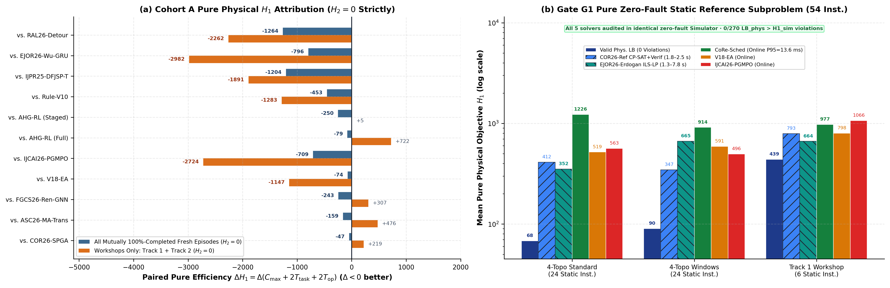
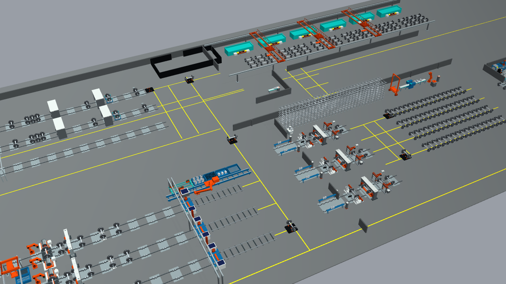

# AMR-Scheduler (`CoRe-Sched`): Learning-Guided Joint Rescheduling with Commitment-Preserving Incremental Optimization

<div align="center">

[](https://github.com/AmaneSuzuha000/AMR-Scheduler/actions/workflows/ci.yml)
[](https://www.python.org/)
[](https://www.rust-lang.org/)
[](https://docs.ros.org/en/humble/)
[](https://gazebosim.org/)
[](https://dotnet.microsoft.com/)
[](LICENSE)

**English** | [简体中文](README_zh.md)

</div>

---

## Overview

**AMR-Scheduler** (`v1.2.1`) is the open-source code and digital-twin companion repository for **`CoRe-Sched`** (*Commitment-aware Rescheduling for Production–Multi-AMR Coordination*), a dual-engine learning-and-optimization platform for dynamic kitting-constrained production and multi-AMR rescheduling in discrete-workstation, narrow-aisle railway maintenance workshops.

<p align="center">
  
</p>

### Core Framework (`CoRe-Sched`)
- **Learning & Causal Repair Engine (`AHG-RL` + `CausalRepairCone`)** (`amr_sched/rl/v19_hetero_graph.py`, `v19_hetero_constructor.py`, `causal_repair_cone.py`, `v10_selector.py`):
  - **5-Entity Heterogeneous Graph Attention Encoder & Pure-NumPy Promotion**: Encodes `Operation`, `Task`, `AMR`, `Bay`, and `Crew` nodes, directed precedence DAGs, bipartite kitting links, and corridor congestion/detour edge features, eagerly promoted to `< 1e-5` pure-NumPy inference matrices inside initialization (zero tick-0 cold-start spikes).
  - **Four-Stage Autoregressive Semantic Constructor (`BC -> KL-Anchored SMDP-PPO`)**: Sequentially decodes *Task Prioritization*, *Resource Assignment* (bay & crew), *Fleet Dispatch* (dynamic load + soft-commitment retention bias), and *Queue Sequencing*.
  - **Online Contextual Selection, Guarded Dual-Arm Probe, Stage-2 `CausalRepairCone` & Oscillation Arbiter**: Combines `Contextual LinUCB` ($\phi(s_t) \in [0, 1]^6$), fleet-guarded dual-arm probing ($|\mathcal{R}| \ge 4$), $J_A$-aligned candidate ranking, bounded Stage-2 Regret-2 `CausalRepairCone` over `FastJAWKittingSurrogate`, active-loading (`_load_end`) + edge safety guards, and symmetric `p4_choke_robust` surgical oscillation wakeups.
- **Incremental Optimization Engine (`CVCR-IR`)** (`amr_sched/cvcr/evaluator.py`, `crates/`):
  - **Sequence-Differenced Incremental Reservation Cache (`CVCR-IR (Seq-Diff)`) + Tightened Footprint-Aware SLA Guard**: Computes exact per-AMR effective task sequences, reuses unchanged AMRs' routes and Rust half-open interval reservations in-place (`median |ΔJ| = 0.00`), re-routes only $\Delta\mathcal{R}$ via native Rust `SpaceTime A* / SIPP` (`41 us` single-agent search), and bounds pooled wall-clock tail latency strictly below `23 ms` (`18.55 ms / 22.62 ms` Pooled P99 `< 35 ms`).
- **Execution Layer (*Atomic Transaction Commit*) & Dual-Layer Digital Twin** (`amr_sched/cvcr/`, `tools/`, `RAWSimO.Live/`):
  - Enforces epoch freshness, irrevocable `LOCKED` commitment protection, `_load_end` / valid-edge checks, and atomic fallback-to-`KEEP` across discrete simulation (`AMRReschedulingEnv`), ROS 2 / Nav2 / Gazebo physical closed-loop execution (`PhysicalCVCRCoordinator`), and the C# WPF digital twin.
  - **Unified Policy Registry (22 Registered Policies)** (`amr_sched/baselines/policy_registry.py`): Includes `core_sched` / `CoRe-Sched` (`V19_ADAPTIVE_RL`), `AHG-RL` ablations, internal CVCR optimizers (`V18_EA_JOINT`, `rule_v10`), architecture-faithful domain-adapted 2025–2026 direct joint production–AGV competitors (`IJPR25_DFJSPT_HMARL`, `ASC26_MA_TRANS`, `FGCS26_REN_GNN`, `SPGA_AMR`), static offline references (`COR26-Ref` CP-SAT master relaxation + path verification solver, `EJOR26-Erdogan`), and broader 2025–2026 baselines (`IJCAI26_PGMPO`, `EJOR26_Wu_GRU_Attn`, `TII26_E2G_MoE`, `ICRA26_Kitting_HGNN`, `RAL26_DetourDelta`, `JAIR26_DyMAB`, `MIT26_TAPFPC_LNS`, `BALANS_IJCAI25`).

---

## Verified Benchmark Highlights (`v1.2.1` NCSR Optimization & Dual-Cohort Blind Closure)

### 1. Dual 120-Episode Holdouts (`240` Blind Episodes / `2,880` Audited Runs, `100%` Audit Pass)

Executed sequentially in uncontended single-process wall-clock runs under strict seed quarantine across **Holdout Cohort A** ([`results/g3_fresh_blind_holdout.csv`](results/g3_fresh_blind_holdout.csv), seeds `[27101..27302]` & `[2901..2906]`) and **Single-Shot Blind Holdout Cohort B** ([`results/g5_pristine_blind_holdout.csv`](results/g5_pristine_blind_holdout.csv), untouched seeds `[37101..37302]` & `[3901..3906]`, executed once post-freeze). Methods marked `*` breach the `35 ms` Pooled P95/P99 real-time SLA.

| Method | **240-Ep Comp (`%`)** ↑ | Cohort A Mean $J_A$ ↓ | Cohort A P95 / P99 (ms) | Cohort B Mean / **Med $J_A$** ↓ | Cohort B P95 / P99 (ms) | **240-Ep Paired $\Delta J_A$ (`p`, `W/T/L`)** |
| :--- | :---: | :---: | :---: | :---: | :---: | :---: |
| **`CoRe-Sched` (`core_sched`)** | **238/240 (99.2% #1)** | **5,177.9 (#1)** | **15.52 / 18.55** | 6,631.5 / **827.5 (#1)** | **19.45 / 22.62** | Reference (`5,904.7` Mean, `1,575.7` Med) |
| `V18-EA`* | 234/240 (97.5%) | 5,654.1 | 27.53 / *79.38* | **5,387.0** / 991.7 | 25.49 / *77.74* | -6.96% (`p = 0.0666`, `99/0/141`) |
| `IJCAI26-PGMPO` | 237/240 (98.8%) | 6,016.5 | 23.13 / *38.81* | 5,532.7 / 843.5 | 22.97 / 34.49 | -2.25% (`p = 0.901`, `116/0/124`) |
| `Rule-V10`* | 234/240 (97.5%) | 6,674.2 | *37.16* / *52.28* | 6,175.6 / 1,455.2 | *35.90* / *51.30* | +8.10% (`p = 0.092`, `127/0/113`) |
| `AHG-RL (Full)` | 235/240 (97.9%) | 6,019.2 | 32.84 / *52.34* | 6,942.6 / 3,610.4 | 33.14 / *42.61* | **+8.89%** (**`p = 0.00135`**, `144/0/96`) |
| `AHG-RL (Staged)`* | 234/240 (97.5%) | 6,469.2 | 30.31 / *54.26* | 6,821.4 / 3,613.7 | *35.59* / *78.51* | **+11.15%** (**`p = 7.25e-5`**, `151/0/89`) |
| `FGCS26-Ren-GNN` | 235/240 (97.9%) | 7,420.4 | 12.68 / 16.05 | 6,240.2 / 3,695.2 | 13.56 / 16.81 | **+13.55%** (**`p = 1.62e-4`**, `148/0/92`) |
| `ASC26-MA-Trans` | 231/240 (96.2%) | 7,776.6 | **12.22 / 16.82** | 6,580.0 / 3,811.9 | **12.01 / 15.30** | **+17.74%** (**`p = 7.35e-4`**, `142/0/98`) |
| `RAL26-DetourDelta` | 234/240 (97.5%) | 6,998.2 | 22.10 / *57.42* | 7,486.5 / 3,683.4 | 27.37 / *61.78* | **+18.47%** (**`p = 1.32e-10`**, `160/0/80`) |
| `COR26-SPGA`* | 234/240 (97.5%) | 7,533.0 | *62.55* / *75.39* | 7,240.1 / 2,920.4 | *62.02* / *73.66* | **+20.06%** (**`p = 4.09e-7`**, `164/0/76`) |
| `EJOR26-Wu-GRU` | 228/240 (95.0%) | 8,857.7 | 33.04 / *52.49* | 7,718.7 / 1,057.2 | 33.88 / *50.04* | **+28.76%** (**`p = 4.37e-4`**, `140/0/100`) |
| `IJPR25-DFJSP-T` | 228/240 (95.0%) | 7,817.4 | 14.85 / 18.05 | 9,253.9 / 3,760.6 | 14.70 / 18.35 | **+30.82%** (**`p = 8.47e-14`**, `166/0/74`) |

- **Highest Completion & Strict Sub-`23 ms` Pooled P99 Across Both Cohorts**: `CoRe-Sched` leads all 12 methods in combined completion (**`238/240 = 99.2%`**), sweeps **Cohort A Rank #1 (`5,177.9`, `120/120`, `15.52 / 18.55 ms` P95/P99)**, leads **Cohort B Median $J_A$ (`827.5` #1)** at **`19.45 / 22.62 ms` P95/P99**, and defeats **8 of 11 comparators cleanly ($p \le 0.00135$)** across the 240 combined episodes (with full disclosure of the two Cohort B unfinished tail outliers `topo4_offset_dual_lane_window_bottleneck_37302 = 78,259.95` and `track2_kitting_windows_3906 = 117,637.65` lifting Cohort B Mean $J_A$ to `6,631.5`).
- **72-Episode Single-Factor Ablations & `2 × 2` Trigger × Solver Decoupling** ([`results/g4_val72_repair_ablation.csv`](results/g4_val72_repair_ablation.csv)): Disabling `CausalRepairCone` (`+14.32%`, $p = 4.30 \times 10^{-5}$), `J_A`-aligned scoring (`+16.21%`, $p = 3.02 \times 10^{-4}$), `AHG-RL` priors (`+28.60%`), or ZeroChurn hysteresis (`+4.60%`) consistently degrades cost, while `RuleV10 + CoRe-Sched` (`4,190.3`, `72/72`) outperforms `V18-EA` (`4,252.9`), `RuleV10 + V18-EA` (`4,359.9`), and `V18Ctrl + CoRe-Sched` (`4,864.7`, `71/72`).
- **Pure Zero-Fault Static Common-Subproblem Reference (54 Instances, `0 / 270` Violations)** ([`results/g1_static_reference_subproblem.csv`](results/g1_static_reference_subproblem.csv)): `COR26-Ref` (offline CP-SAT master relaxation + conflict-free path verification reference solver, `LB_phys = 68.2 / 90.2 / 438.7`, `Sim-UB = 412.4 / 346.8 / 793.0`, `0` claimed exact optima) and `EJOR26-Erdogan` (`ILS-LP`, `352.1 / 664.8 / 664.5`) satisfy `LB_phys <= H1_sim` across all 270 runs (`CoRe-Sched` static Pooled P95/P99 = `13.61 / 20.47 ms`).
- **`CVCR-IR (Seq-Diff)` Cache Synergy, Physical Reconciliation & Scaling**: Restores isolated neural candidate hit rate from **`0.00%`** (`CVCR-IR Base`) to **`73.68%`** (`1.48×` speedup, `median |ΔJ| = 0.00`; `86.8%–94.7%` closed-loop hits); 5-seed ROS 2 / Nav2 / Gazebo physical reconciliation achieves Track 1 $\rho = 0.7857$ (`7.18 ms` physical P95); 10-AMR scaling sustains **`23.57 ms < 35 ms`** P95 (`2.21×` faster than full rebuild).

<p align="center">
  
</p>

<p align="center">
  
</p>

<p align="center">
  
</p>

<p align="center">
  
  
</p>

---

## Quick Start

```bash
git clone https://github.com/AmaneSuzuha000/AMR-Scheduler.git
cd AMR-Scheduler

# 1. Build native Rust spatiotemporal kernel (reservation_core & spacetime_planner)
cargo build --release --manifest-path crates/Cargo.toml

# 2. Install Python package and dependencies
pip install -r requirements.txt
pip install -e ".[dev,viz,web,rl]"

# 3. Run workshop simulation, NCSR ablations, Dual-Cohort blind suites & 7 figures
python -m amr_sched --tasks 50 --agvs 6 --layout workshop --planner rust_spacetime_astar
python -B experiments/run_post_v120_audit_and_ablation.py
python -B experiments/run_g5_pristine_blind_holdout.py
python -B experiments/run_dual_layer_reconciliation.py --multi-seed
python -B experiments/run_workshop_scaling_4axis.py
python -B experiments/plot_v19_paper_figures.py

# 4. Run verification test suites (Python, Rust, C#, Manifest)
python -m pytest -q
cargo test --manifest-path crates/Cargo.toml
dotnet test Tests/RAWSimO.Live.Tests/RAWSimO.Live.Tests.csproj -c Release
python tools/data_manifest.py --check
```

---

## Project Structure

```text
AMR-Scheduler/
├── amr_sched/                  # CoRe-Sched Python core, CVCR-IR engine, RL env, and simulator
│   ├── allocation/             # Dispatching rules (FIFO/EDD/SPT/CR), Hungarian & composable allocators
│   ├── baselines/              # Unified policy registry (`core_sched`), pure-NumPy backends & 2025-2026 baselines
│   ├── checkpoints/            # Packaged pure-NumPy (.npz) and PyTorch (.pt) inference weights
│   ├── cvcr/                   # Causal snapshot, CVCR-IR (Seq-Diff) evaluator, frontier synthesis, Owner & Auditor
│   ├── planners/               # Dijkstra, Spacetime A*, Rust A*, Rust batch SIPP
│   ├── rl/                     # AHG-RL 5-entity Hetero-GNN constructor, CausalRepairCone, Contextual LinUCB & SMDP env
│   └── viz/                    # Workshop layout, Gantt, corridor heatmaps, trajectories, animations
├── crates/                     # Native Rust Cargo workspace (reservation_core & spacetime_planner)
├── RAWSimO.Live/               # C# (.NET 6) live TCP JSONL protocol consumer & topology tracker
├── RAWSimO.Visualization/      # C# WPF 2D visualizer & live monitoring UI
├── tools/                      # Benchmarks, ROS 2 / Nav2 / Gazebo bridges, 1:25 wheelset scene
├── experiments/                # Training, NCSR ablations, Dual-Cohort blind evaluation, reconciliation & plotting
├── results/                    # Verified CSV datasets, MANIFEST.json, 7 publication figures (`fig1`–`fig7`)
├── docs/architecture/          # System architecture specification and ADRs
├── web/                        # FastAPI WebSocket monitoring & replay console
└── Tests/                      # Python pytest suites + C# xUnit test suites
```

---

## Documentation & License

- **Architecture & Protocols**: [Architecture Spec](docs/architecture/ARCHITECTURE.md), [ADR 001 (Rust FFI)](docs/architecture/decisions/001_cdylib_ctypes_architecture.md), [ADR 002 (Transaction & Auditor)](docs/architecture/decisions/002_transaction_auditor_data_flow.md), [PROTOCOLS.md](PROTOCOLS.md), [CHANGELOG.md](CHANGELOG.md)
- **License**: Original code is licensed under **GPL-3.0**. Upstream RAWSim-O components retain their original licenses. See [LICENSE](LICENSE) and [ThirdPartyLicenses.txt](ThirdPartyLicenses.txt).
