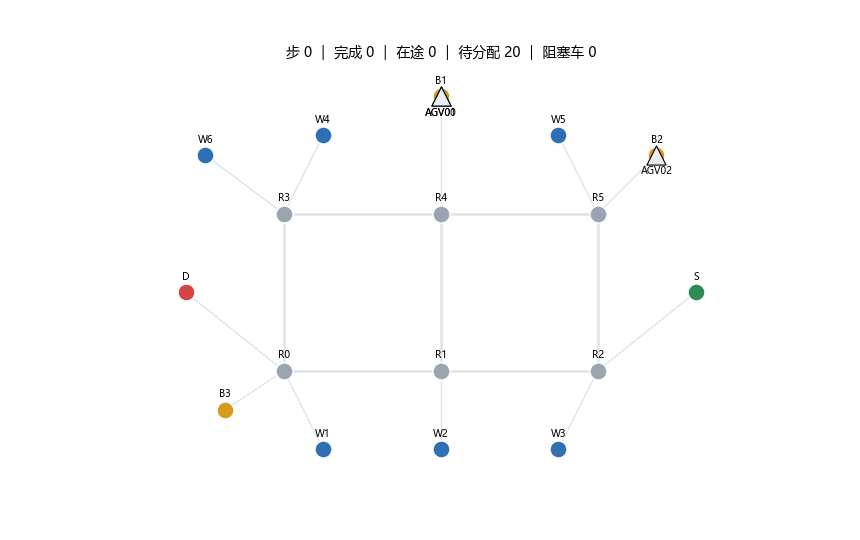
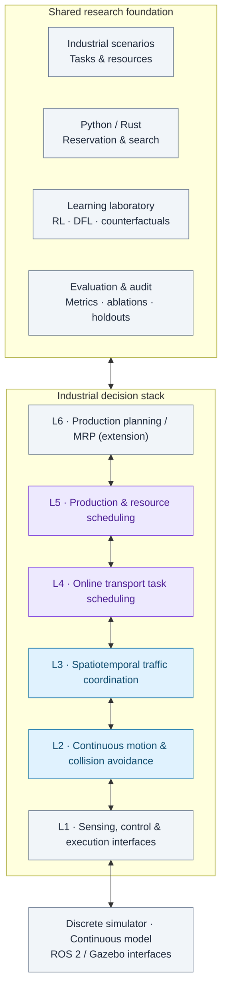
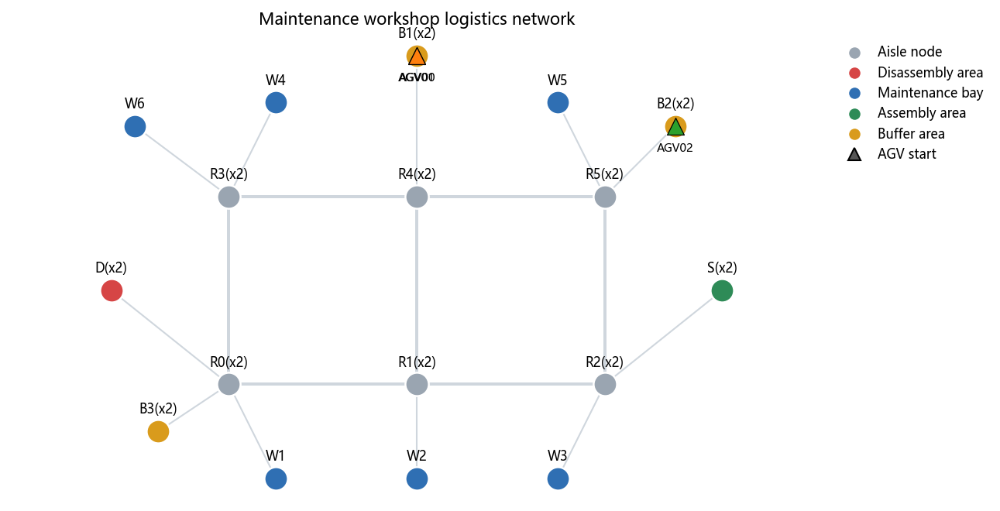
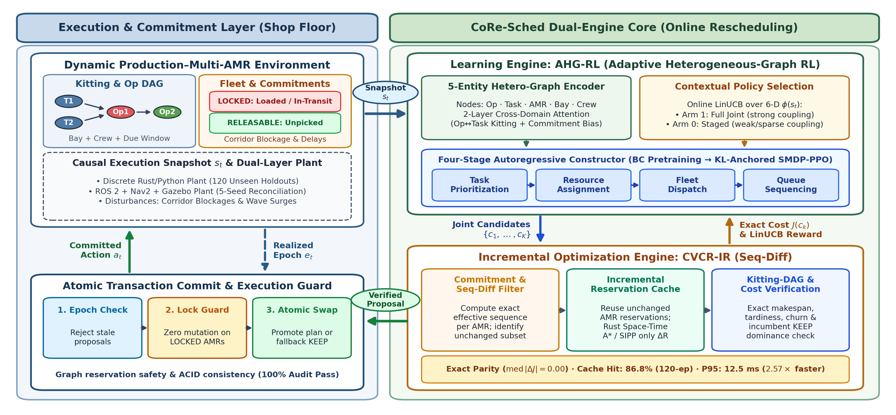
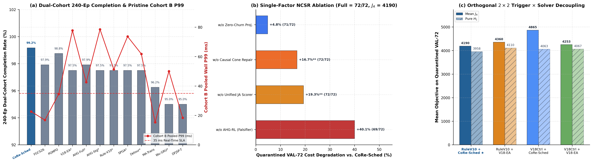

<div align="center">

# AMR-Scheduler

**A multi-fidelity research platform for Industrial AI, multi-robot coordination and intelligent operations.**

*From production decisions to spatiotemporal planning and physical execution.*

[](https://github.com/AmaneSuzuha000/AMR-Scheduler/actions/workflows/ci.yml)
[](https://www.python.org/)
[](https://www.rust-lang.org/)
[](https://docs.ros.org/en/humble/)
[](LICENSE)

**English** · [简体中文](README_zh.md)

[Research tracks](#research-tracks) · [Platform](#platform-architecture) · [Evidence](#research-evidence) · [Quick start](#quick-start)

</div>

---

## Overview

AMR-Scheduler is a long-term research infrastructure for autonomous mobile robots (AMRs), industrial intralogistics and production–transport optimization. Rather than binding a simulator to a single algorithm, it supports distinct scientific questions through shared industrial models, spatiotemporal reservation kernels, learning environments, execution backends and evaluation protocols.

Its research objective is to connect **operations research, machine learning and physically executable multi-robot decisions**. The platform supports both fast abstract experiments and higher-fidelity execution studies, with explicit attention to safety, liveness, solution quality, latency and reproducibility.

<p align="center">
  
</p>
<p align="center"><sub>Existing workshop simulation visualization; not a recording of a physical robot fleet.</sub></p>

| **24** registered policies | **240** Track B holdout episodes | **2** research tracks |
| :---: | :---: | :---: |
| Shared algorithm registry | Two historical evaluation cohorts | Traffic & production logistics |


## Research tracks

| | Track A — Traffic & Physical Execution | Track B — Production & Transport Scheduling |
|---|---|---|
| **Research question** | Spatiotemporal coordinated planning and physical collision avoidance under execution uncertainty | Commitment-preserving online joint rescheduling of production resources and mobile robots |
| **Decision layers** | L2–L3, with L1 execution interfaces | L4–L5 |
| **Repository methods** | CPS-A*, SIPP, EALR, EdgeSpan, R1_Robust | CoRe-Sched, CVCR-IR, AHG-RL, V19, V20.1 / PDG 2.0 |
| **Learning** | Safety-bounded motion and coordination studies; active exploration | Heterogeneous graph learning, BC / SMDP-PPO, contextual selection |
| **Status** | Active research | Historical benchmark stack retained for reproducibility |

CoRe-Sched is a research outcome of Track B, not a synonym for the entire platform. Cross-layer production–traffic feedback is a future research direction; the two tracks currently retain separate validated boundaries.

## Platform architecture



The diagram is a conceptual architecture, not a claim that every layer is already integrated into one production-ready controller. The current dual-backend interface is a compatibility-audit implementation rather than a stable public SDK.

### Shared research capabilities

| Infrastructure | Current scope |
|---|---|
| Industrial modelling | Workshop topology, transport tasks, production operations, bays, crews and kitting dependencies |
| Planning & optimization | Python/Rust space–time search, SIPP, congestion guidance, interval reservations and incremental evaluation |
| Learning laboratory | Graph learning, reinforcement learning, contextual bandits, decision-focused learning and counterfactual experiments |
| Multi-fidelity execution | Discrete simulation, continuous kinematic/geometry models, ROS 2 and Gazebo integration components |
| Evidence & verification | Independent auditing, commitment checks, ablations, held-out evaluation, manifests and CI |
| Visualization | Matplotlib figures, trajectory replay, web monitoring and RAWSim-O-based C# visualization |

<p align="center">
  
  
</p>
<p align="center"><sub>Existing Gazebo workshop model and its planning topology.</sub></p>

## Research evidence

Selected results documented in the public repository. Each result belongs to its own protocol; they are not directly comparable across tracks.

| Study | Reported result | Evidence |
|---|---|---|
| Track B · CoRe-Sched dual holdout | 238/240 completed episodes (99.2%); pooled P99 18.55 / 22.62 ms across two cohorts | [Cohort A](results/g3_fresh_blind_holdout.csv) · [Cohort B](results/g5_pristine_blind_holdout.csv) |
| Track B · Mechanism attribution | 72-episode ablations and trigger × solver comparison | [Ablation data](results/g4_val72_repair_ablation.csv) |
| Track A · Robust capsule shield | 36/36 observed confirmation episodes without detected collisions | [Safety report](results/ramp_robust/robust_ramp_report.md) |
| Track A · EdgeSpan / ETA attribution | +7.00% completed tasks in the reported EdgeSpan attribution test; threshold calibration reduces unnecessary replanning | [Attribution](results/foundation_audit/track_a_attribution.md) |
| Cross-track · Multi-fidelity audit | 38/38 continuous replays without detected collisions; policy rank inversions reveal abstraction limits | [Compatibility report](results/foundation_audit/foundation_compatibility_report.md) |

<details>
<summary>Track B: benchmark and mechanism figures</summary>

<p align="center">
  
  
</p>

The two incomplete holdout episodes are retained in the results. CoRe-Sched is not the best method on every cost metric. Literature-derived competitors include domain-adapted implementations; consult the experiment protocol before interpreting rankings as comparisons with published original results.

</details>

### Active research frontier

The current Track A research programme investigates execution-aware time-dependent congestion guidance in SIPP (EA-CPSIPP), physical dependency graphs and local incremental repair (Physical PDG / PartialCone), event-driven learning for traffic recovery (CARL / CARE-RL), native physical simulation acceleration and feedback-driven Gazebo execution.

These are ongoing research candidates. The latest local experiments and implementations are not all present on the public main branch; no final blind-test, formal safety guarantee, real-robot deployment or general RL superiority is claimed here.

## Quick start

Requirements: Python 3.10+ and a Rust toolchain. ROS 2, Gazebo and .NET 6 are optional for their respective integration components. The following commands follow the existing repository entry points.

```bash
git clone https://github.com/AmaneSuzuha000/AMR-Scheduler.git
cd AMR-Scheduler
cargo build --release --manifest-path crates/Cargo.toml
python -m pip install -r requirements.txt
python -m pip install -e ".[dev,viz,web,rl]"
python -m amr_sched --tasks 50 --agvs 6 --layout workshop --planner rust_spacetime_astar
```

### Verification

```bash
python -m pytest -q
cargo test --manifest-path crates/Cargo.toml
dotnet test Tests/RAWSimO.Live.Tests/RAWSimO.Live.Tests.csproj -c Release
python tools/data_manifest.py --check
```

The .NET command requires its own toolchain. Research holdouts are intentionally not part of the quick-start workflow; preserve the original experiment protocol and use a separate development set when changing algorithms.

## Repository map

| Path | Purpose |
|---|---|
| [`amr_sched/`](amr_sched/) | Python models, schedulers, planning adapters, policies and learning |
| [`crates/`](crates/) | Native Rust reservation and planning workspace |
| [`experiments/`](experiments/) | Research-specific runners, training and evaluation |
| [`results/`](results/) | Experimental tables, reports and publication figures |
| [`scenes/`](scenes/) · [`simulation/`](simulation/) | Scenario and simulation assets |
| [`tools/`](tools/) · [`interop/`](interop/) | Bridges, verification and integration utilities |
| [`RAWSimO.Live/`](RAWSimO.Live/) · [`RAWSimO.Visualization/`](RAWSimO.Visualization/) | C# live transport and visualization |
| [`web/`](web/) · [`Tests/`](Tests/) | Monitoring and automated tests |

## Development roadmap

- [x] Shared industrial models and native spatiotemporal planning kernels
- [x] Track B historical holdouts and mechanism ablations
- [x] Initial dual-fidelity compatibility audit and physical safety experiments
- [ ] Time-dependent planning and local repair attribution on final-version code
- [ ] Independent RL benefit over strong deterministic alternatives
- [ ] Feedback-driven external physics validation and real-robot integration
- [ ] Versioned public research SDK, experiment registry and benchmark packages

## Documentation & license

[Architecture](docs/architecture/ARCHITECTURE.md) · [Protocols](PROTOCOLS.md) · [Changelog](CHANGELOG.md) · [Contributing](CONTRIBUTING.md) · [RAWSim-O upstream notes](README-RAWSimO.md)

Original code is licensed under [GPL-3.0](LICENSE). Upstream RAWSim-O components retain their original licenses; see [ThirdPartyLicenses.txt](ThirdPartyLicenses.txt). CPS-A* research follows the original [CPSAStar-TRC](https://github.com/pengguo-hub/CPSAStar-TRC) work. Attribution does not imply endorsement or a license grant for external material.

This is research software, not a certified industrial safety controller. Reported safety and latency results are conditional on their experimental protocols.
