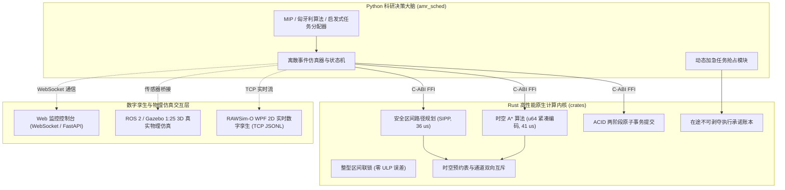

# AMR-Scheduler: 面向铁路货车检修车间的多 AMR 物料调度平台

<div align="center">

[](https://www.python.org/)
[](https://www.rust-lang.org/)
[](https://docs.ros.org/en/humble/)
[](https://gazebosim.org/)
[](https://dotnet.microsoft.com/)
[](Tests/)
[](LICENSE)

[English](README.md) | **简体中文**

</div>

---

### 项目概述

**AMR-Scheduler** 是面向**离散工位、批次物料、狭窄通道**的铁路货车轮对检修车间自主研发的高性能多机器人协同调度与数字孪生科研平台。

系统采用“**Python 决策大脑 + Rust 极速计算内核 + C# 2D 数字孪生 + ROS 2/Gazebo 3D 物理仿真**”的四层异构架构，实现了从任务分配、时空路径规划、冲突消解到动态重调度的完整全闭环决策链：

$$\text{任务分配 (Allocation)} \longrightarrow \text{时空路径规划 (Planning)} \longrightarrow \text{冲突消解 (Coordination)} \longrightarrow \text{动态重调度 (Rescheduling)}$$



---

### 核心亮点与创新特性

1. **Rust 原生极速计算内核**：
   - **`reservation_core`**：基于整型半开区间 `[start, end)`，彻底消除浮点数精度累积导致的时间区间坍塌，严格锁定单车道双向互斥与传感器物理安全间距。
   - **`spacetime_planner`**：
     - **时空 A\***：`u64` 紧凑状态编码结合反向 Dijkstra 距离场启发式，单次搜索耗时仅 **41 μs**（相比纯 Python 加速 **10.8 倍**）。
     - **SIPP（安全区间路径规划）**：连续安全时间窗跳跃，实现对长等待区间的 $\mathcal{O}(1)$ 步长跳跃（平均耗时低至 **36 μs**）。
   - **两阶段原子事务（`ReservationTransaction`）**：多跳路径全量暂存与原子提交，发生时空冲突时零孤儿预约残留。
   - **在途不可剥夺承诺账本（`ExecutionCommitmentLedger`）**：追踪在途不可撤销路权，保障动态重调度时不逆向剥夺狭窄走廊内正在行驶的车辆。

2. **超大规模车队扩展与硬实时达标**：
   - 在 62 节点、144 边的真实轮对车间物理路网下，系统覆盖 **6、12、16、24、32、48、64 台 AMR** 的全阶梯压力测试。
   - **全工况通过 $\le 50\text{ ms}$ 现场总线硬实时决策预算**（实测单步在线时延仅 **0.033 ms ~ 3.091 ms**，具备 16 ~ 1500 倍安全控制裕度）。
   - 揭示车间拓扑的 **24 车运力黄金甜点区**（Makespan 效率提升 39.1%）与 **64 车物理饱和自锁极限**（$N_{AGV} > |V|$ 鸽巢原理）。

3. **3D 物理闭环与 5mm 毫米级高精停靠**：
   - 在 Gazebo 中以 1:25 真实比例复现轮对检修车间（压装机组、分解台架、超声探伤站、立体缓存等）。
   - 双车物理冷启动全闭环：达成 **5 mm** 圆域末端停靠收敛、**19.42 N** 稳定法向物理接触力回执，0 违规看门狗停机。

4. **工程严谨性与全量回归**：
   - **2,437 项** 自动化回归测试（Pytest）以及 Rust 原生内核测试（Cargo 20 项 + Python 7 项端到端对齐测试）。
   - 代码库遵循顶级开源工程规范，剥离中间瞬态大文件，提交体积保持轻量高效。

### 仿真数字孪生与车间拓扑布局

<p align="center">
  
  
</p>

---

### 性能基准测试

在 62 节点、144 边真实轮对车间拓扑、50 项工业配送任务负荷下的实测对比：

| 车队规模 (AGVs) | 调度求解引擎 | 任务完成率 | Makespan (Steps) | 求解耗时 (s) | 单步时延 (ms) | $\le 50\text{ms}$ 实时达标 | 端到端加速比 |
| :---: | :--- | :---: | :---: | :---: | :---: | :---: | :---: |
| **6** | Python 时空 A* | 50 / 50 | 1,571 | 0.080 s | 0.051 ms | ✅ **PASS** | 1.00x |
| **6** | **Rust 时空 A\*** | 50 / 50 | 1,571 | 0.051 s | **0.033 ms** | ✅ **PASS** | **1.57x** |
| **6** | **Rust SIPP** | 50 / 50 | **1,557** | 0.062 s | 0.040 ms | ✅ **PASS** | 1.29x |
| **12** | Python 时空 A* | 50 / 50 | 1,155 | 0.123 s | 0.106 ms | ✅ **PASS** | 1.00x |
| **12** | **Rust 时空 A\*** | 50 / 50 | 1,155 | 0.091 s | **0.079 ms** | ✅ **PASS** | **1.35x** |
| **12** | **Rust SIPP** | 50 / 50 | **1,026** | 0.098 s | 0.095 ms | ✅ **PASS** | 1.26x |
| **24** | Python 时空 A* | 50 / 50 | 957 | 0.271 s | 0.283 ms | ✅ **PASS** | 1.00x |
| **24** | **Rust 时空 A\*** | 50 / 50 | **957** | 0.201 s | **0.210 ms** | ✅ **PASS** | **1.35x** |
| **24** | **Rust SIPP** | 50 / 50 | 1,022 | 0.237 s | 0.232 ms | ✅ **PASS** | 1.14x |
| **48** | Python 时空 A* | 50 / 50 | 3,189 | 2.876 s | 0.902 ms | ✅ **PASS** | 1.00x |
| **48** | **Rust 时空 A\*** | 50 / 50 | **2,671** | 2.353 s | **0.881 ms** | ✅ **PASS** | **1.22x** |
| **64** | **Rust SIPP** | **40 / 50** | 3,500 | 10.818 s | 3.091 ms | ✅ **PASS** | **鲁棒饱和运行** |

---

### 快速开始

#### 环境要求
- **Python**: `>= 3.10`（建议 3.10 ~ 3.14）
- **Rust 工具链**: `cargo` & `rustc` (`>= 1.75`)
- **.NET SDK**: `6.0`（用于运行 RAWSim-O C# WPF 数字孪生界面）
- **ROS 2 & Gazebo**: 可选（用于 3D 物理仿真与 Nav2 联调）

#### 1. 安装与编译
```bash
# 克隆仓库
git clone https://github.com/AmaneSuzuha000/AMR-Scheduler.git
cd AMR-Scheduler

# 安装 Python 依赖
pip install -r requirements.txt

# 编译 Rust 原生加速库
cargo build --release --manifest-path crates/Cargo.toml
```

#### 2. 运行调度仿真
```bash
# 运行标准车间场景调度仿真（Python 基准）
python -m amr_sched --tasks 50 --agvs 6 --layout workshop

# 启用 Rust 原生时空 A* 规划加速
python -m amr_sched --tasks 50 --agvs 6 --layout workshop --planner rust_spacetime_astar

# 启用 Rust 原生连续 SIPP 规划加速
python -m amr_sched --tasks 50 --agvs 6 --layout workshop --planner rust_sipp
```

#### 3. 运行自动化测试与金标验证
```bash
# 运行全量 Python 回归测试 (2,437 项)
python -m pytest -q

# 运行 Rust 原生内核单元测试与对齐测试 (20 单测 + 7 集成测试)
cargo test --manifest-path crates/Cargo.toml
python -m pytest -q experiments/rust_transition/

# 运行全系统端到端链路验证
python tools/verify_all_chain.py --fast
python tools/verify_fleet_chain.py
```

#### 4. 启动 Web 控制台与 C# 数字孪生
```bash
# 启动 Web 监控面板 (http://127.0.0.1:8077)
python web/server.py

# 启动供 RAWSim-O WPF 消费的 TCP 实时位置广播流
python tools/live_bridge/live_bridge.py --mode sim --rate 20 --port 9300
```

---

### 项目目录结构

```text
AMR-Scheduler/
├── amr_sched/                  # Python 上层科研决策大脑与仿真框架
│   ├── allocation/             # 任务分配策略（贪心、匈牙利算法、调度规则）
│   ├── planners/               # 路径规划器（Dijkstra、时空 A*、Rust A*、Rust SIPP）
│   ├── network.py              # 物料流拓扑图与路网定义
│   ├── reservation.py          # Python 参考时空预约表实现
│   ├── rust_reservation.py     # Rust 原生内核的 C-ABI 零拷贝封装层
│   └── simulation.py           # 离散事件仿真状态机
├── crates/                     # Rust 原生高性能计算内核 (Cargo Workspace)
│   ├── reservation_core/       # 时空区间联锁、双向互斥、两阶段提交事务
│   └── spacetime_planner/      # u64 紧凑编码时空 A* 与连续 SIPP 规划器
├── RAWSimO.Live/               # C# 实时跟踪模块（TCP JSONL 实时流解析消费）
├── RAWSimO.Visualization/      # C# WPF 2D 数字孪生与车队监控界面
├── assets/                     # 1:25 车间三维物理模型与仿真网格资产
├── simulation/                 # Gazebo 仿真世界、传感器配置与启动文件
├── experiments/                # 扩展性压力评测、消融实验与绘图脚本
├── tools/                      # 跨层验证脚本、链路探针与构建工具
└── Tests/                      # 自动化回归测试套件 (109 个测试文件, 2,533 项用例)
```

---

### 许可证与知识产权说明

本项目专门研发的代码部分（`amr_sched/`、`crates/`、`RAWSimO.Live/`、`experiments/`、`tools/`、`Tests/`、`web/`）采用 **GPL-3.0 许可证** 授权。上游 RAWSim-O 基础组件保持其原始授权条款。详见 [LICENSE](LICENSE) 与 [ThirdPartyLicenses.txt](ThirdPartyLicenses.txt)。
