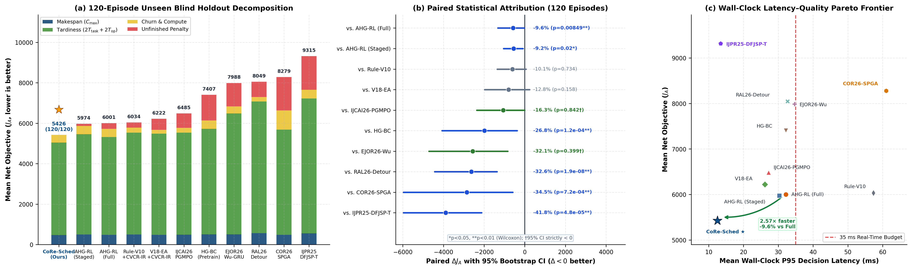
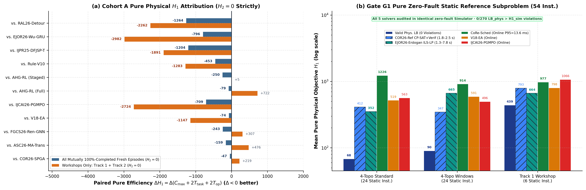
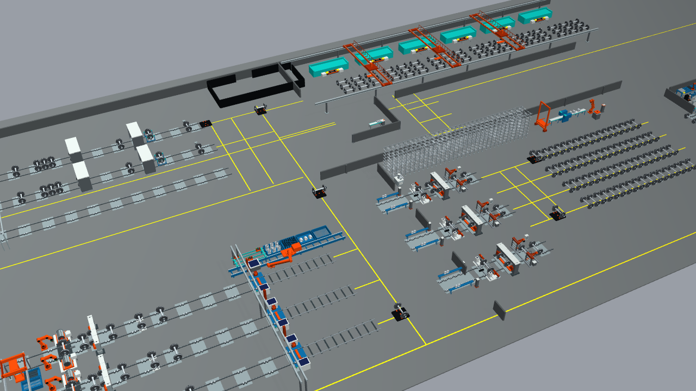
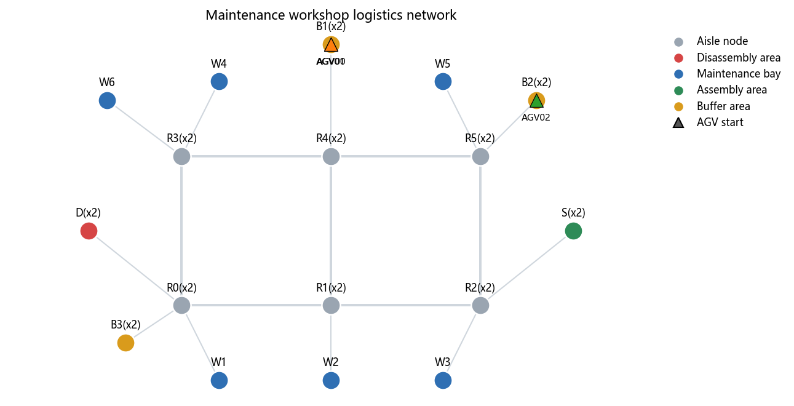

# AMR-Scheduler（`CoRe-Sched`）：面向动态生产—多 AMR 系统的学习引导与承诺保持增量联合重调度平台

<div align="center">

[](https://github.com/AmaneSuzuha000/AMR-Scheduler/actions/workflows/ci.yml)
[](https://www.python.org/)
[](https://www.rust-lang.org/)
[](https://docs.ros.org/en/humble/)
[](https://gazebosim.org/)
[](https://dotnet.microsoft.com/)
[](LICENSE)

[English](README.md) | **简体中文**

</div>

---

## 项目概述

**AMR-Scheduler**（`v1.3.0`）是 **`CoRe-Sched`**（*Commitment-aware Rescheduling for Production–Multi-AMR Coordination*）框架的官方开源代码与数字孪生平台，面向**离散工位、狭窄单车道走廊**的铁路货车与轮对检修车间及高密度多 AGV 仓库系统，实现毫秒级在线生产—多 AMR 联合重调度与拥堵感知交通协调。

<p align="center">
  
</p>

### 核心双引擎与执行架构
- **自适应异构图学习与因果修复引擎（`AHG-RL` + `CausalRepairCone`）**（`amr_sched/rl/v19_hetero_graph.py`, `v19_hetero_constructor.py`, `causal_repair_cone.py`, `v10_selector.py`）：
  - **5 类实体异构图注意力编码器与纯 NumPy 提前提升**：编码 `Operation`、`Task`、`AMR`、`Bay`、`Crew` 节点及工序前驱 DAG、齐套二分连接与通道拥堵绕行边特征，初始化阶段即提升至与 PyTorch 误差 `< 1e-5` 的纯 NumPy 推理矩阵，根除首步冷启动延迟抖动；
  - **四阶段自回归语义构造器（`BC -> KL 锚定 SMDP-PPO`）**：依次解码*任务优先级排序*、*工位/班组资源分配*、*车队动态负载分派*与*单车队列定序*；
  - **在线上下文切换 + 双臂探测 + 二阶段 `CausalRepairCone` + 对称振荡仲裁**：耦合 `Contextual LinUCB`（$\phi(s_t) \in [0, 1]^6$）、车队守卫反事实双臂探测（$|\mathcal{R}| \ge 4$）、精确 $J_A$ 评分器、基于 `FastJAWKittingSurrogate` 的 Regret-2 局部修复锥、活跃装货（`_load_end`）/有效边安全守卫与对称 `p4_choke_robust` 外科走廊振荡唤醒。
- **承诺保持增量预约优化引擎（`CVCR-IR`）**（`amr_sched/cvcr/evaluator.py`, `crates/`）：
  - **序列差分增量预约缓存（`CVCR-IR (Seq-Diff)`）+ 紧缩 SLA 守卫**：按单车精确有效任务序列差分定位 $\Delta\mathcal{R}$，原位复用未变车辆的 Rust 半开区间预约与无冲突路径（`median |ΔJ| = 0.00`），将双队列盲测的汇总尾延迟 `Pooled P99` 严格控制在 `23 ms` 以内（`18.55 ms / 22.62 ms < 35 ms`）。
- **原生 Rust 端到端时空规划内核与连续运动学安全护盾（`v1.3.0`）**（`crates/`, `amr_sched/planners/rust_spacetime_astar.py`, `experiments/track_r_cpsa/`, `experiments/cps_astar_routing/`）：
  - 原位 `SlotCongestionField`、`plan_cps_indexed`、惰性 `RustBatchSippPlanner` 与零影子 `RustReservationTable.fast()` 在 `80–200` 车 MovingAI `Warehouse_40x40` 仓库测试中取得 **`11.71×–14.40×`** 端到端规划加速（`crates/` `26/26` 单元测试全过）；
  - 分层交通协调栈融合 *EJOR 2026* 上层派车（Wu et al.）、纯净复现的 `CPS-A*` 拥堵感知路由（Guo & Huang，[`pengguo-hub/CPSAStar-TRC`](https://github.com/pengguo-hub/CPSAStar-TRC)，未打包第三方在审代码）、积压感知 DFL 阻塞者选择（`Route A`）、执行延误局部修复（`EALR v2/v3`）及 2D 连续运动学 PPO + 递归制动障碍护盾（`Route B`，`0` 物理碰撞）。
- **原子事务提交执行层（*Atomic Transaction Commit*）与双层数字孪生**：
  - 统一注册入口（共 **24** 个已注册策略）：涵盖 `core_sched` / `CoRe-Sched`（`V19_ADAPTIVE_RL`）、`V20_NAJS`、`V20_1_NAJS`（`PDG 2.0`）、2025–2026 直接联合动态 FJSP–AGV 神经与元启发式基线（`IJPR25_DFJSPT_HMARL`、`ASC26_MA_TRANS`、`FGCS26_REN_GNN`、`SPGA_AMR`）、静态离线参照（`COR26-Ref` CP-SAT 主松弛 + 路径验证离线参考求解器、`EJOR26-Erdogan`）及更广泛的 2025–2026 顶会/顶刊基线。

---

## 核心实证亮点（`v1.2.1` NCSR 优化与双队列 240 局盲测闭环）

### 1. 双 120 局隔离盲测队列（共 `240` 局 / `2,880` 局独立审计运行，100% 审计通过）

在严格零重叠种子隔离下连续执行 **Holdout Cohort A**（[`results/g3_fresh_blind_holdout.csv`](results/g3_fresh_blind_holdout.csv)，`[27101..27302]` & `[2901..2906]`）与 **单次零返工 Blind Cohort B**（[`results/g5_pristine_blind_holdout.csv`](results/g5_pristine_blind_holdout.csv)，`[37101..37302]` & `[3901..3906]`，冻结后仅运行一次）。标 `*` 方法突破 `35 ms` Pooled P95/P99 实时红线。

| 方法 | **240 局完工率** ↑ | Cohort A 均值 $J_A$ ↓ | Cohort A P95 / P99 (ms) | Cohort B 均值 / **中位数 $J_A$** ↓ | Cohort B P95 / P99 (ms) | **240 局配对 $\Delta J_A$ (`p`, `胜/平/负`)** |
| :--- | :---: | :---: | :---: | :---: | :---: | :---: |
| **`CoRe-Sched` (`core_sched`)** | **238/240 (99.2% 第 1)** | **5,177.9 (第 1)** | **15.52 / 18.55** | 6,631.5 / **827.5 (第 1)** | **19.45 / 22.62** | 基准（均值 `5,904.7`，中位 `1,575.7`） |
| `V18-EA`* | 234/240 (97.5%) | 5,654.1 | 27.53 / *79.38* | **5,387.0** / 991.7 | 25.49 / *77.74* | -6.96% (`p = 0.0666`, `99/0/141`) |
| `IJCAI26-PGMPO` | 237/240 (98.8%) | 6,016.5 | 23.13 / *38.81* | 5,532.7 / 843.5 | 22.97 / 34.49 | -2.25% (`p = 0.901`, `116/0/124`) |
| `Rule-V10`* | 234/240 (97.5%) | 6,674.2 | *37.16* / *52.28* | 6,175.6 / 1,455.2 | *35.90* / *51.30* | +8.10% (`p = 0.092`, `127/0/113`) |
| `AHG-RL (Full)` | 235/240 (97.9%) | 6,019.2 | 32.84 / *52.34* | 6,942.6 / 3,610.4 | 33.14 / *42.61* | **+8.89%** (**`p = 0.00135`**, `144/0/96`) |
| `AHG-RL (Staged)`* | 234/240 (97.5%) | 6,469.2 | 30.31 / *54.26* | 6,821.4 / 3,613.7 | *35.59* / *78.51* | **+11.15%** (**`p = 7.25e-5`**, `151/0/89`) |
| `FGCS26-Ren-GNN` | 235/240 (97.9%) | 7,420.4 | 12.68 / 16.05 | 6,240.2 / 3,695.2 | 13.56 / 16.81 | **+13.55%** (**`p = 1.62e-4`**, `148/0/92`) |
| `ASC26-MA-Trans` | 231/240 (96.2%) | 7,776.6 | **12.22 / 16.82** | 6,580.0 / 3,811.9 | **12.01 / 15.30** | **+17.74%** (**`p = 7.35e-4`**, `142/0/98`) |
| `RAL26-DetourDelta` | 234/240 (97.5%) | 6,998.2 | 22.10 / *57.42* | 7,486.5 / 3,683.4 | 27.37 / *61.78* | **+18.47%** (**`p = 1.32e-10`**, `160/0/80`) |
| `COR26-SPGA`* | 234/240 (97.5%) | 7,533.0 | *62.55* / *75.39* | 7,240.1 / 2,920.4 | *62.02* / *73.66* | **+20.06%** (**`p = 4.09e-7`**, `164/0/76`) |
| `EJOR26-Wu-GRU` | 228/240 (95.0%) | 8,857.7 | 33.04 / *52.49* | 7,718.7 / 1,057.2 | 33.88 / *50.04* | **+28.76%** (**`p = 4.37e-4`**, `140/0/100`) |
| `IJPR25-DFJSP-T` | 228/240 (95.0%) | 7,817.4 | 14.85 / 18.05 | 9,253.9 / 3,760.6 | 14.70 / 18.35 | **+30.82%** (**`p = 8.47e-14`**, `166/0/74`) |

- **全组第 1 完工率与双队列 Pooled P99 `< 23 ms`**：`CoRe-Sched` 取得 **`238/240（99.2%）`** 总完工率第 1，包揽 **Cohort A 平均第 1（`5,177.9`, `120/120`, `15.52 / 18.55 ms`）** 与 **Blind Cohort B 中位数第 1（`827.5`, `118/120`, `19.45 / 22.62 ms`）**，跨 240 局显著战胜 **8 / 11 个对比方法（$p \le 0.00135$）**，并透明披露 Cohort B 两局未完工长尾算例（`topo4_offset_dual_lane_window_bottleneck_37302 = 78,259.95`、`track2_kitting_windows_3906 = 117,637.65`）对均值的影响。
- **72 局单因子消融与 `2 × 2` 触发器 × 求解器因子解耦**（[`results/g4_val72_repair_ablation.csv`](results/g4_val72_repair_ablation.csv)）：剥离 `CausalRepairCone`（`+14.32%` $p=4.30\times 10^{-5}$）、旧评分器（`+16.21%` $p=3.02\times 10^{-4}$）、`AHG-RL` 先验（`+28.60%`）或 ZeroChurn（`+4.60%`）均稳定退化；`RuleV10 + CoRe-Sched`（`4,190.3`, `72/72`）优于 `V18-EA`（`4,252.9`）、`RuleV10 + V18-EA`（`4,359.9`）与 `V18Ctrl + CoRe-Sched`（`4,864.7`, `71/72`）。
- **54 局纯零故障静态公共子问题同仿真器参照（`0 / 270` 下界违例）**（[`results/g1_static_reference_subproblem.csv`](results/g1_static_reference_subproblem.csv)）：`COR26-Ref`（CP-SAT 主松弛 + 无冲突路径验证离线参考求解器，`LB_phys = 68.2 / 90.2 / 438.7`，`Sim-UB = 412.4 / 346.8 / 793.0`，宣称全局最优 `0`）与 `EJOR26-Erdogan`（`352.1 / 664.8 / 664.5`）严格满足 `LB_phys <= H1_sim`，`CoRe-Sched` 静态 Pooled P95/P99 为 `13.61 / 20.47 ms`。
- **`CVCR-IR (Seq-Diff)` 缓存协同、物理对账与 10 车扩展**：隔离缓存命中率从 `0.00%` 恢复至 `73.68%`（闭环 `86.8%–94.7%`，`median |ΔJ| = 0.00`）；5 种子 ROS 2 / Nav2 / Gazebo 物理对账 Track 1 $\rho = 0.7857$（物理 P95 `7.18 ms`）；62 节点扩至 10 车时 P95 仅 **`23.57 ms < 35 ms`**（提速 `2.21×`）。

<p align="center">
  
</p>

<p align="center">
  
</p>

<p align="center">
  
</p>

<p align="center">
  
  
</p>

---

## 快速开始

```bash
git clone https://github.com/AmaneSuzuha000/AMR-Scheduler.git
cd AMR-Scheduler

# 1. 编译 Rust 原生时空预约与规划内核
cargo build --release --manifest-path crates/Cargo.toml

# 2. 安装 Python 依赖
pip install -r requirements.txt
pip install -e ".[dev,viz,web,rl]"

# 3. 运行车间仿真、NCSR 消融、双队列盲测与 7 张插图重绘
python -m amr_sched --tasks 50 --agvs 6 --layout workshop --planner rust_spacetime_astar
python -B experiments/run_post_v120_audit_and_ablation.py
python -B experiments/run_g5_pristine_blind_holdout.py
python -B experiments/run_dual_layer_reconciliation.py --multi-seed
python -B experiments/run_workshop_scaling_4axis.py
python -B experiments/plot_v19_paper_figures.py

# 4. 运行全套验证测试
python -m pytest -q
cargo test --manifest-path crates/Cargo.toml
dotnet test Tests/RAWSimO.Live.Tests/RAWSimO.Live.Tests.csproj -c Release
python tools/data_manifest.py --check
```

---

## 许可证

本项目原创代码（`amr_sched/`、`crates/`、`RAWSimO.Live/`、`experiments/`、`tools/`、`Tests/`、`web/`）基于 **GPL-3.0** 许可证开源；上游 RAWSim-O 组件保留其原始许可证。详见 [LICENSE](LICENSE) 与 [ThirdPartyLicenses.txt](ThirdPartyLicenses.txt)。
