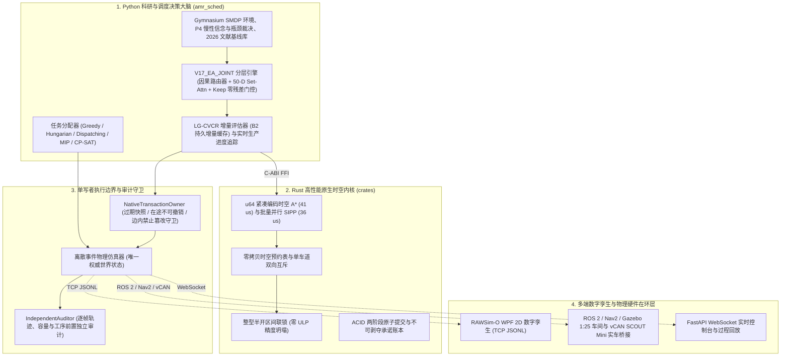

# AMR-Scheduler：面向铁路货车检修车间的多 AMR 协同调度与数字孪生平台

<div align="center">

[](https://github.com/AmaneSuzuha000/AMR-Scheduler/actions/workflows/ci.yml)
[](https://www.python.org/)
[](https://www.rust-lang.org/)
[](https://docs.ros.org/en/humble/)
[](https://gazebosim.org/)
[](https://dotnet.microsoft.com/)
[](Tests/)
[](LICENSE)

[English](README.md) | **简体中文**

</div>

---

## 项目概述

**AMR-Scheduler**（`v0.3.0`）是面向**离散工位、批次齐套、狭窄通道**铁路货车轮对检修车间研发的高性能多机器人协同调度、分层执行感知重调度与数字孪生科研平台。

系统采用四层同步闭环架构：

$$\text{严格因果快照} \longrightarrow \text{V17 分层决策大脑} \longrightarrow \text{Rust 时空预约内核} \longrightarrow \text{原子事务提交与数字孪生}$$



---

## 核心特性

### 1. V17 分层执行感知调度大脑（`V17_EA_JOINT`）与纯 NumPy 随库权重
- **严格因果快照（`NativeSnapshotCapture`）**：冻结在途及已取料任务（`FROZEN_COMMITMENT`），隐藏未释放任务（`hide_future_releases=True`），严格禁止边内行驶态（`_transit`）违规重规划。
- **因果模式路由器 + 50-D 成对时间窗排序器（`v17_window_protection.py`）**：将无拓扑 Leakage 的因果情境路由器（`V15_SOFT` / `V7_CALM` / `V10_GUIDED`）与“36-D 结构特征 + 14-D 成对时间窗收益”的 Set-Attention 残差排序器结合，并施加 **Keep 零残差保守门控**。
- **P4 慢性信念更新与多跳瓶颈通道裁决（`p4_belief_choke.py`）**：在线估计持久拥堵/障碍持续时间，在单车道桥梁与狭窄走廊通过方向令牌与安全避让湾（Safe Haven）协同放行。
- **事件级 SMDP 执行反馈闭环（`v17_event_smdp.py`、`physical_bridge.py`）**：将物理行进漂移、动态阻塞告警与绕行重路由统一纳入虚拟/墙钟计算窗口预算。
- **无 PyTorch 轻量部署**：已将训练好的 `lrho`、`v12`–`v17` 推理权重打包为纯 NumPy `.npz` 文件置于 `amr_sched/checkpoints/`（`< 1 MB`），在纯净 CI 或工业边缘机上实现亚毫秒级在线推断。
- **Gymnasium 强化学习环境与 2026 顶会基线库（`amr_sched/rl/`、`amr_sched/baselines/`）**：内置动作掩码 Dueling DQN / SMDP 控制器，并在统一因果快照与 ACID 事务约束下复现 `Wu EJOR'26`、`Choi IJCAI'26`、`Ma TII'26`、`Sow JAIR'26`、`Parimi MIT'26`、`Zhang ICRA'26`、`BalansBanditPhan24`、`ReijnenDRALNS24`、`WangESWA24`、`ShiAEI25` 等方法。

### 2. Rust 原生极速计算内核（`crates/`）
- **`reservation_core`**：基于整型半开区间 `[start, end)`，消除浮点 ULP 误差，提供单车道双向互斥、索引化零拷贝表查询与两阶段原子提交事务。
- **`spacetime_planner`**：`u64` 紧凑编码时空 A\*（单次平均 **41 μs**，较纯 Python 加速 **10.8 倍**）与批量并行 **SIPP**（单次平均 **36 μs**）。
- **C-ABI 安全隔离（`ffi_guard!`）**：所有 `extern "C"` 导出接口均包裹 `std::panic::catch_unwind`，防止异常跨越语言边界。

### 3. 1:25 轮对车间物理闭环、ROS 2 / Nav2 与 SCOUT Mini 桥接
- **1:25 Gazebo 物理车间（`assets/`、`simulation/`、`tools/live_bridge/`）**：高精度还原轮对压装机组、分解台架、探伤站与缓存区，完成 5 mm 末端圆域停靠收敛与 19.42 N 稳定法向支撑回执闭环。
- **ROS 2 / Nav2 / SocketCAN 实车链路（`tools/ros2/`、`tools/live_bridge/vcan_gazebo_bridge.py`）**：支持 Costmap 走廊投影、RViz2 协同态势叠加（`amr_v15_digital_twin.rviz`）以及 AgileX SCOUT Mini CAN 2.0B（`0x421`/`0x211`/`0x221`）协议编解码与虚拟 `vcan0` 回环测试。
- **C# `RAWSimO.Live` 数字孪生与 Web 监控**：通过 TCP JSONL 实时流（见 [PROTOCOLS.md](PROTOCOLS.md)）接入 WPF 2D 监控画面与 FastAPI WebSocket 控制台（`web/server.py`）。

---

## 核心实验表现

### V17 跨赛道全审计大基准（E4：6 个盲测赛道，448 组独立场景，100% 轨迹审计通过）

在全部 6 个盲测赛道（`UNSEEN_STD`、`HOLDOUT_V17_FINAL`、`NEW_A`、`STRESS_5AXIS`、`EXP_D_160`、`EXEC_P45_VOI`）中，**`V17_EA_JOINT`** 是唯一实现 **100.0% 任务完单率（`TCR = 1.000`）、100.0% 生产工序完成率（`PCR = 1.000`）、0 未完工罚分与 448/448 全轨迹独立审计通过** 的方法：

| 评测赛道 (`n`) | `V17_EA_JOINT` 均值净成本 (中位数) | `V17` 完单率 / 未完工罚分 | `V16_EA_JOINT` 均值 | `rl_v7` 均值 | `rule_v10` 均值 | 最优文献基线 (均值) |
| :--- | :---: | :---: | :---: | :---: | :---: | :---: |
| **`UNSEEN_STD`** (`24`) | **1,022.49** (`843.46`) | **1.000 / 0.0** | 1,093.72 | 1,053.72 | 1,618.37 | `WangESWA24` (`1,079.09`) |
| **`HOLDOUT_V17`** (`24`) | 1,364.93 (`1,073.03`) | **1.000 / 0.0** | **1,307.90** | 2,736.36 | 12,078.98 | `BalansBanditPhan24` (`2,901.61`) |
| **`NEW_A`** (`72`) | 1,829.19 (`1,811.24`) | **1.000 / 0.0** | 1,944.76 | 1,982.32 | **1,772.98** | `WangESWA24` (`2,722.34`) |
| **`STRESS_5AXIS`** (`24`) | 3,485.82 (`2,502.56`) | **1.000 / 0.0** | 3,544.55 | 3,460.88 | **3,428.44** | `ShiAEI25` (`3,919.27`) |
| **`EXP_D_160`** (`160`) | 4,385.19 (`4,108.48`) | **1.000 / 0.0** | 4,399.00 (`未完工罚 162.5`) | 5,594.73 | 5,639.22 | `BalansBanditPhan24` (`4,803.69`) |
| **`EXEC_P45_VOI`** (`144`) | 2,177.75 (`2,151.65`) | **1.000 / 0.0** | 2,177.31 | 2,226.90 | **2,107.68** | `ReijnenDRALNS24` (`2,758.71`) |

<p align="center">
  
  
</p>

<p align="center">
  
  
</p>

### 车队规模扩展性与 Rust 内核加速基准（62 节点、144 边真实车间，50 项任务）

| 车队规模 (AGVs) | 求解引擎 | 任务完成率 | Makespan (Steps) | 求解耗时 (s) | 单步时延 (ms) | $\le 50\text{ ms}$ 实时达标 | 加速比 |
| :---: | :--- | :---: | :---: | :---: | :---: | :---: | :---: |
| **6** | Rust 时空 A\* | 50 / 50 | 1,571 | 0.051 s | **0.033 ms** | ✅ PASS | **1.57x** |
| **12** | Rust SIPP | 50 / 50 | **1,026** | 0.098 s | 0.095 ms | ✅ PASS | 1.26x |
| **24** | Rust 时空 A\* | 50 / 50 | **957** | 0.201 s | **0.210 ms** | ✅ PASS | **1.35x** |
| **48** | Rust 时空 A\* | 50 / 50 | **2,671** | 2.353 s | **0.881 ms** | ✅ PASS | **1.22x** |
| **64** | Rust SIPP | 40 / 50 | 3,500 | 10.818 s | 3.091 ms | ✅ PASS | 拓扑饱和极限 ($N > |V|$) |

---

## 快速开始

### 环境要求
- **Python**: `>= 3.10`（CI 已验证 `3.11` / `3.12`，本地已验证 `3.14`）
- **Rust 工具链**: `cargo` 与 `rustc`（`>= 1.75`）
- **.NET SDK**: `6.0`（用于运行与测试 `RAWSimO.Live`）
- **ROS 2 Humble & Gazebo**: 可选（用于 3D 物理 HIL 与 Nav2 联调）

### 1. 克隆仓库、安装依赖与编译 Rust 内核
```bash
git clone https://github.com/AmaneSuzuha000/AMR-Scheduler.git
cd AMR-Scheduler

# 编译 Rust 原生动态库 (reservation_core & spacetime_planner)
cargo build --release --manifest-path crates/Cargo.toml

# 安装核心 Python 依赖（包含 rl 可选依赖可运行完整 RL/CP-SAT/2026 基线测试）
pip install -r requirements.txt
pip install -e ".[dev,viz,web,rl]"
```

### 2. 运行调度仿真
```bash
# Python 时空 A* 基准
python -m amr_sched --tasks 50 --agvs 6 --layout workshop

# 启用 Rust 时空 A* / 连续 SIPP 加速
python -m amr_sched --tasks 50 --agvs 6 --layout workshop --planner rust_spacetime_astar
python -m amr_sched --tasks 50 --agvs 6 --layout workshop --planner rust_sipp
```

### 3. 运行自动化测试与验证链路
```bash
# 全量 Python 回归测试（纯净 CI 检出含 135 个测试文件：2,098 项运行通过 + 42 项本地私有证据自动跳过）
python -m pytest -rs

# Rust 内核单元测试（24 项）与 Python-Rust 差分测试（7 项）
cargo test --manifest-path crates/Cargo.toml
python -m pytest -q experiments/rust_transition/

# C# RAWSimO.Live 测试套件（34 个文件共 197 项 xUnit 用例）
dotnet test Tests/RAWSimO.Live.Tests/RAWSimO.Live.Tests.csproj -c Release

# 数据清单签名、Demo B 帧流与跨层联调验证
python tools/data_manifest.py --check
python tools/verify_demo_b.py
python tools/verify_fleet_chain.py --steps 60
python tools/verify_all_chain.py --fast
```

### 4. 启动 Web 监控面板与实时数字孪生
```bash
# 启动 Web 监控台 (http://127.0.0.1:8077)
python web/server.py

# 启动供 RAWSim-O WPF 消费的 TCP 实时位置广播流
python tools/live_bridge/live_bridge.py --mode sim --rate 20 --port 9300
```

---

## 目录结构

```text
AMR-Scheduler/
├── amr_sched/                  # Python 调度决策大脑、CVCR 引擎、RL 环境与仿真器
│   ├── allocation/             # 贪心、匈牙利算法、派工规则与可组合分配器
│   ├── baselines/              # 2024–2026 顶会文献算法的统一因果基线适配
│   ├── checkpoints/            # 随库打包的纯 NumPy .npz 推理权重 (L-RHO, V12–V17)
│   ├── cvcr/                   # 快照捕获、B2 评估器、V12–V17 策略、P4 信念与事务审计
│   ├── planners/               # Dijkstra、时空 A*、Rust A*、Rust SIPP 与零拷贝批量 FFI
│   ├── rl/                     # Gymnasium SMDP 环境、动作掩码、V10/V12/V13 控制器与 CUDA 后端
│   ├── viz/                    # 拓扑图、甘特图、通道负载热图、轨迹回放与动画生成
│   ├── rust_reservation.py     # reservation_core 的 C-ABI 零拷贝封装
│   └── simulation.py           # 单写者离散事件仿真状态机
├── crates/                     # Rust 原生计算内核 (Cargo Workspace)
│   ├── reservation_core/       # 整型区间预约表、双向互斥、两阶段原子提交与承诺账本
│   └── spacetime_planner/      # u64 时空 A*、批量连续 SIPP 与 ffi_guard! 边界保护
├── RAWSimO.Live/               # C# (.NET 6) 实时 TCP JSONL 协议解析与车队拓扑跟踪
├── RAWSimO.Visualization/      # C# WPF 2D 实时数字孪生监控界面
├── tools/
│   ├── live_bridge/            # Gazebo / Nav2 / SCOUT v2 CAN 硬件桥接与走廊代价地图投影
│   ├── ros2/                   # ROS 2 Humble 安全护栏节点、SCOUT 模型资产与 RViz/Nav2 配置
│   ├── wheelset_scene/         # 1:25 轮对检修车间场景构建与全线就绪验证脚本
│   ├── data_manifest.py        # 34 份核心实验 CSV 的 SHA-256 与统计摘要完整性校验
│   ├── verify_all_chain.py     # 跨层端到端联调验收总入口
│   └── ...                     # 车队流服务、仿真桥桩、差分基准评测脚本
├── experiments/                # 规模/矩阵基准脚本、Rust 差分测试与 V17 绘图脚本
├── results/                    # 34 份权威基准 CSV、MANIFEST.json、实验图表与 HTML 回放
├── docs/architecture/          # 系统架构规范与架构决策记录 (ADR 001 / ADR 002)
├── web/                        # FastAPI WebSocket 监控与回放控制台
└── Tests/                      # 135 个 Python 测试文件 + 34 个 C# 测试文件 (RAWSimO.Live.Tests)
```

---

## 文档与许可证

- **架构规范与 ADR**：[系统架构规范](docs/architecture/ARCHITECTURE.md)、[ADR 001 (Rust cdylib FFI)](docs/architecture/decisions/001_cdylib_ctypes_architecture.md)、[ADR 002 (事务与审计数据流)](docs/architecture/decisions/002_transaction_auditor_data_flow.md)
- **通信协议与变更记录**：[PROTOCOLS.md](PROTOCOLS.md)、[CHANGELOG.md](CHANGELOG.md)、[CONTRIBUTING.md](CONTRIBUTING.md)
- **开源协议**：本项目自研代码（`amr_sched/`、`crates/`、`RAWSimO.Live/`、`experiments/`、`tools/`、`Tests/`、`web/`）采用 **GPL-3.0 协议**；上游 RAWSim-O 基础组件保留其原有授权条款。详见 [LICENSE](LICENSE) 与 [ThirdPartyLicenses.txt](ThirdPartyLicenses.txt)。
