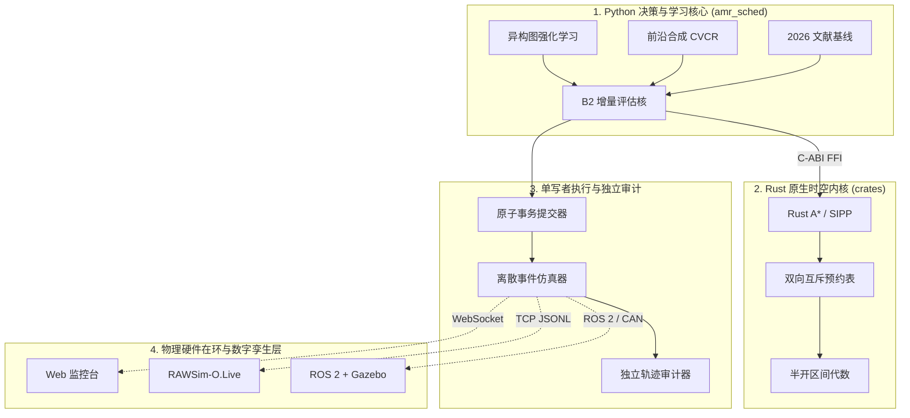

# AMR-Scheduler：面向铁路检修车间的执行感知时空预约与异构图联合调度平台

<div align="center">

[](https://github.com/AmaneSuzuha000/AMR-Scheduler/actions/workflows/ci.yml)
[](https://www.python.org/)
[](https://www.rust-lang.org/)
[](https://docs.ros.org/en/humble/)
[](https://gazebosim.org/)
[](https://dotnet.microsoft.com/)
[](LICENSE)

[English](README.md) | **简体中文**

</div>

---

## 项目概述

**AMR-Scheduler**（`v1.0.0`）是面向**离散工位、批次齐套、狭窄单车道走廊**铁路货车与轮对检修车间研发的多 AMR 协同物料配送、工序-物流联合重调度与数字孪生开源平台。

系统由四层同步闭环架构组成：

$$\text{严格因果快照} \longrightarrow \text{异构图关键链联合构造与 CVCR 决策核} \longrightarrow \text{Rust 时空预约内核} \longrightarrow \text{原子事务提交与 ROS 2 / Gazebo 数字孪生}$$



---

## 核心特性

### 1. 异构图关键链联合构造与执行感知 CVCR（`amr_sched/`）
- **`Can–Should` 执行承诺调整价值学习框架（`NativeSnapshotCapture`, `classify_commitments`）**：
  - **`Can`（物理与承诺可行子空间）**：严格冻结在途及已取料不可撤销承诺（`PICKED`, `LOADING`, `UNLOADING`, `_transit` 归入 `FROZEN_COMMITMENT`），屏蔽未释放任务（`hide_future_releases=True`），并接入连续物理层执行反馈（`ExecutionFeedbackPacket`）。
  - **`Should`（跨窗口长期反事实调整价值）**：联合评估修改现有任务/工位/班组承诺能否在下游齐套开工与关键链拖期上获得足以抵消切换抖动（$15\cdot\Delta C$）及级联放大风险的长期净收益。
- **异构图关键链联合构造器（`v19_hetero_graph.py`, `v19_hetero_constructor.py`）**：
  - 编码 `5` 类车间实体节点（工序 `Operation [12-D]`、运输任务 `Task [12-D]`、车队 `AMR [10-D]`、工位 `Bay [8-D]`、班组 `Crew [4-D]`）及关系与走廊拥堵特征张量（工序前驱邻接 `op_dag_adj [3-ch]`、齐套归属 `task_to_op`、工位适配与拥堵边 `op_bay_feats [4-D]`、班组掩码 `op_crew_mask`、任务-车辆候选边 `task_agv_feats [8-D]` 与工位绕行增量 `bay_detour_norm`）。
  - 执行 2 层双向异构消息传递（`encode_entities`: `op_dag_msg`, `kit_task_to_op`, `kit_op_to_task`, `op_bay_mha`, `op_crew_mha`, `task_agv_mha`），随后依次通过四阶段耦合解码头生成联合动作：工位与班组选择（`A2`: `bay_logits`, `crew_logits`）、关键链任务焦点排序（`A1`: `task_focus_logits`）、基于所选工位（`sel_bay_proj`）与累计车队负载（`agv_dyn_proj`）的自回归指针式 AMR 分派（`A3`），以及队列插入优先级排序（`A4`: `a4_seq_scores`）。
  - 采用多专家 B2 加权行为克隆（`experiments/train_v19_bc.py`）热启动与 KL 锚定闭环 SMDP PPO（`experiments/train_v19_rl.py`, `reward_mode="net_obj"`）微调，并导出纯 NumPy `.npz` 推理权重（与 PyTorch 相对误差 `< 1e-5`），支持无 PyTorch 的 ROS 2 物理协调器实时闭环运行。
- **状态条件化的自适应跨域耦合控制（`experiments/run_v19_exp06_adaptive_coupling.py`）**：仅基于当前快照时刻 $t$ 的 6 维局部状态耦合特征 $\phi(s_t) \in \mathbb{R}^6$（齐套瓶颈率、前驱链密度、时间窗悬崖紧迫度、工位绕行离散度、车队延迟率与并发负载，零拓扑标签输入）动态调节跨域联合深度。
- **执行感知前沿合成与单车道瓶颈走廊信念裁决（`v18_frontier_synthesis.py`, `v17_window_protection.py`, `p4_belief_choke.py`）**：融合工序资源时间窗保护、非平稳走廊阻塞持续时间生存估计（`CVaR`）与单车道方向令牌裁决。
- **统一策略注册表与 2024–2026 文献基线库（`amr_sched/baselines/`）**：支持 `V19_HETERO_RL`、`V18_EA_JOINT`、`rule_v10` 以及 `Wu EJOR'26`、`Choi IJCAI'26 (PGMPO)`、`Ma TII'26`、`Hirayama RA-L'26 (DetourDelta)`、`Jia Li COR'26 (SPGA)`、`Zhang ICRA'26`、`Sow JAIR'26`、`Parimi MIT'26`、`Cai IJCAI'25 (BALANS)` 在离散仿真与物理桥接器（`PhysicalCVCRCoordinator`）中的即插即用对比，并提供 `Wu et al. (EJOR 2026)` 3D 立体仓拣选 VRP 的独立复现（`experiments/ejor26_warehouse_repro/`）。

### 2. Rust 原生时空预约与路径规划内核（`crates/`）
- **`reservation_core`**：基于整型半开区间 `[start, end)` 消除浮点 ULP 漂移，提供单车道双向互斥、零拷贝索引查询与 ACID 两阶段原子提交事务。
- **`spacetime_planner`**：`u64` 紧凑编码 **时空 A\***（单次平均 **41 μs**，较纯 Python 加速 **10.8 倍**）与批量并行 **SIPP**（单次平均 **36 μs**），通过 `ffi_guard!` 保证跨 C-ABI 边界异常安全。

### 3. ROS 2 / Nav2 / Gazebo 物理车间与数字孪生闭环（`tools/`, `RAWSimO.Live/`）
- **双轨真实车间拓扑与物理仿真**：
  - **Track 1（`rail_freight_workshop_v1`）**：62 节点、144 边铁路货车检修车间（6 台 AMR，转向架/轮对/制动/车钩多工序齐套耦合）。
  - **Track 2（`wheelset_workshop_v2`）**：50 节点 1:25 轮对检修车间（3 台 AMR，压装/探伤/分解物理工位，集成 AMCL/EKF 定位、Nav2 局部控制与 `amr_gazebo_guard` C++ 安全看门狗）。

---

## 核心实验结果

### 1. 120 局未见盲测基准与自适应跨域耦合（单进程真实墙钟，纯 NumPy 推理，100% 轨迹审计通过）

| 策略 / 消融变体 | 方法说明 | 审计通过率 | 100% 完总局 | 任务完工率 | 工序完工率 | 平均 `net_obj` ↓ | 平均 `cmax` ↓ | 平均总拖期 ↓ | Track 1 (`62` 节点车间) `net_obj` ↓ |
| :--- | :--- | :---: | :---: | :---: | :---: | :---: | :---: | :---: | :---: |
| **`V19_ADAPTIVE_BANDIT`** | 基于 $\phi(s_t) \in \mathbb{R}^6$ 的在线上下文 Bandit 自适应耦合 (`59%` Full / `41%` Staged) | **100.0%** | **119/120** | **99.93%** | **99.90%** | **5637.77 (#1)** | 484.6 | **2350.5 (#1)** | 5086.58 |
| **`V19_STAGED_RL`** | 分阶段消融（生产与运输弱耦合表示）+ SMDP PPO | **100.0%** | 118/120 | 99.83% | **99.90%** | 5974.11 | 499.4 | 2481.0 | 5507.17 |
| **`V19_ADAPTIVE_RULE`** | 瞬时状态耦合阈值门控 ($C(\phi(s_t)) \ge \theta_c$) | **100.0%** | 118/120 | 99.69% | 99.22% | 5978.48 | **478.2 (#1)** | 2373.3 | 5743.71 |
| **`V19_HETERO_RL`** | 完整异构图关键链联合构造 + 闭环 SMDP PPO | **100.0%** | 118/120 | 99.76% | 99.43% | 6001.36 | 479.4 | 2421.1 | **5085.62 (#1 Fixed)** |
| **`rule_v10`** | 抖动校准多专家规则组合策略 | **100.0%** | 117/120 | 99.75% | 99.48% | 6034.34 | 497.9 | 2516.5 | 6805.22 |
| **`V18_EA_JOINT`** | 执行感知前沿合成 + 资源时间窗保护 | **100.0%** | 114/120 | 99.52% | 98.85% | 6221.95 | 484.9 | 2500.8 | 6292.42 |
| **`IJCAI26_PGMPO`** | Choi et al. (*IJCAI* 2026) 双注意力多策略优化 | **100.0%** | 115/120 | 99.37% | 98.50% | 6484.58 | 493.3 | 2521.6 | 6910.19 |
| **`V19_NO_PROD_COMM`** | 屏蔽生产与承诺异构通道复合消融 + SMDP PPO | **100.0%** | 116/120 | 98.95% | 98.33% | 7034.51 | 496.1 | 2511.0 | 5567.71 |
| **`V19_HETERO_BC`** | 多专家 B2 加权行为克隆（无闭环 RL 微调） | **100.0%** | 115/120 | 98.45% | 98.18% | 7407.27 | 506.2 | 2610.1 | 6038.99 |
| **`EJOR26_Wu_GRU_Attn`** | Wu et al. (*EJOR* 2026) GRU 指针注意力调度 | **100.0%** | 116/120 | 98.83% | 97.68% | 7988.12 | 506.2 | 2988.5 | 7420.09 |
| **`RAL26_DetourDelta`** | Hirayama et al. (*IEEE RA-L* 2026) 绕行增量在线 MAPD | **100.0%** | 115/120 | 98.74% | 98.74% | 8048.61 | 561.5 | 3257.8 | 7462.83 |

### 2. 7 项成本归因、`C0`→`C3` 耦合梯度定律与 6 维正交机制消融（`EXP-01`–`EXP-05`）

- **100% 完总局交集条件归因（`EXP-02`）**：
  - 在 `V19_HETERO_RL`（Full）与 `V19_STAGED_RL`（Staged）均 100% 完成所有任务与工序的 **117 / 120 局交集（占 97.5%）** 上，**`Full` 的平均 `net_obj` 为 `5431.53`，显著优于 `Staged` 的 `5704.10`（净降低 `-272.58 / -4.78%`）**；在与 `V19_HETERO_BC` 均 100% 完工的 **113 / 120 局交集** 上，PPO 在零失败惩罚下仍以 **`-98.03`（66 胜 / 47 负）** 击败 BC，同时将未完工失败惩罚降低了 **`-991.67`（占总收益的 `70.5%`）**。
- **受控生产—运输耦合强度梯度定律（`EXP-04`，固定 62 节点车间、6 车、8 任务、6 工序）**：
  - 在独立单物料弱耦合工况（`C0_Weak`）下，`Staged`（`4035.34`）优于 `Full`（`9711.53`）；一旦激活共享工位/班组竞争（`C1_Moderate`）、多任务齐套 + 3 级前驱链（`C2_Strong`）或动态走廊阻塞（`C3_Extreme`），**`Full` 在全部耦合等级下均反超 `Staged`（`C1` 降低 `-26.21%`，`C2` 降低 `-20.17%`，`C3` 降低 `-1.62%`）**。
- **6 维单因素正交消融（`EXP-05`）**：
  - 保留全部输入特征、仅切断编码层 `Op <-> Task` 跨域消息边（`no_cross_edge_msg`）会使成本恶化 **`+45.86%`**（`9911.00 → 14456.45`）；仅屏蔽齐套瓶颈特征（`no_kit_features`）恶化 **`+43.70%`**；仅关闭 `A4` 队列排序头（`no_a4_seq`）恶化 **`+18.84%`**；仅移除工序前驱 DAG（`no_op_dag`）恶化 **`+16.12%`**；仅屏蔽承诺层级特征（`no_commit_features`）恶化 **`+11.12%`**；而仅关闭解码层 `A2 工位 -> A3 车辆` 硬条件投射（`no_a3_bay_cond`）则改善 **`-2.18%`**（`9695.28`），精确锁定了解码阶段硬条件投射是级联误差放大的来源。

### 3. 统一目标函数 $J_{\mathrm{unified}} = J_A$ 下的 5 种子双层对账及四维压测（`EXP-07`）

- **统一目标 5 种子双层秩相关**：在 `seeds = (101, 202, 303, 404, 505)` 与统一目标 $J_{\mathrm{unified}} = C_{\max} + 2T_{\mathrm{task}} + 2T_{\mathrm{op}} + 5000U_{\mathrm{task}} + 3000U_{\mathrm{op}} + 15C + 0.05M$ 下，Track 1 离散与物理层目标 Spearman 秩相关 **$\rho = 0.8857$** (Makespan $\rho = 1.0000$)；Track 2 秩相关 **$\rho = 0.7714$**，**`V19_HETERO_RL` 在两层保持零秩漂移（均为第 3 名）**，物理层成本较 `V18_EA_JOINT` 降低 **`-17.1%`**、较 `rule_v10` 降低 **`-31.5%`**（单步协调耗时 `p95 = 15.37 ms`, `p99 = 17.38 ms < 35 ms`）。
- **62 节点四维可扩展性压测**：在 4 车紧运力（`agvs_4`）、动态走廊阻塞（`execution_blockage`，目标成本较各基线降低 **20.6%–35.3%**）以及全部 4 档实时决策预算（`20 / 35 / 50 / 100 ms`）下，**`V19_HETERO_RL` 均排名第 1**。

<p align="center">
  
  
</p>

---

## 快速开始

```bash
git clone https://github.com/AmaneSuzuha000/AMR-Scheduler.git
cd AMR-Scheduler

# 1. 编译 Rust 原生时空预约与规划内核
cargo build --release --manifest-path crates/Cargo.toml

# 2. 安装 Python 依赖
pip install -r requirements.txt
pip install -e ".[dev,viz,web,rl]"

# 3. 运行车间调度仿真、双层物理对账与四维压测
python -m amr_sched --tasks 50 --agvs 6 --layout workshop --planner rust_spacetime_astar
python -B experiments/run_dual_layer_reconciliation.py
python -B experiments/run_workshop_scaling_4axis.py

# 4. 运行全套验证测试
python -m pytest -q
cargo test --manifest-path crates/Cargo.toml
dotnet test Tests/RAWSimO.Live.Tests/RAWSimO.Live.Tests.csproj -c Release
python tools/data_manifest.py --check
```

---

## 许可证

本项目原创代码（`amr_sched/`、`crates/`、`RAWSimO.Live/`、`experiments/`、`tools/`、`Tests/`、`web/`）基于 **GPL-3.0** 许可证开源；上游 RAWSim-O 组件保留其原始许可证。详见 [LICENSE](LICENSE) 与 [ThirdPartyLicenses.txt](ThirdPartyLicenses.txt)。
