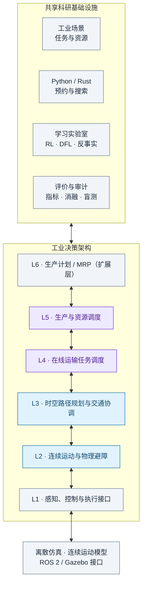
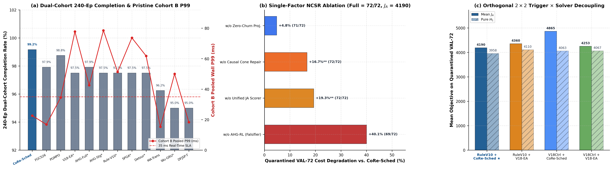

<div align="center">

# AMR-Scheduler

**面向工业人工智能、多机器人协同与智能运筹优化的多保真度科研平台**

*从生产决策、时空规划，到连续物理执行。*

[](https://github.com/AmaneSuzuha000/AMR-Scheduler/actions/workflows/ci.yml)
[](https://www.python.org/)
[](https://www.rust-lang.org/)
[](https://docs.ros.org/en/humble/)
[](LICENSE)

[English](README.md) · **简体中文**

[研究主线](#研究主线) · [平台架构](#平台架构) · [实验证据](#实验证据) · [快速开始](#快速开始)

</div>

---

## 项目概述

AMR-Scheduler 是面向自主移动机器人（AMR）、工业内物流与生产—运输联合优化的长期科研基础设施。平台并不绑定某一个算法，而是通过共享工业模型、时空预约内核、学习环境、执行后端和实验协议，支撑多个独立科学问题的研究。

核心目标是连接**运筹优化、机器学习与物理可执行的多机器人决策**，支持快速抽象实验与更高保真度的执行研究，同时关注安全性、系统活性、解质量、实时性及可复现性。

<p align="center">
  
</p>
<p align="center"><sub>现有车间仿真可视化，非真实机器人车队录像。</sub></p>

| **24** 项注册策略 | **240** 局 Track B 历史盲测 | **2** 条独立研究主线 |
| :---: | :---: | :---: |
| 共享算法注册体系 | 双隔离评价队列 | 时空协同与生产物流 |


## 研究主线

| | Track A · 时空协同与物理避障 | Track B · 生产物流联合调度 |
|---|---|---|
| **科学问题** | 面向执行不确定性的多移动机器人时空协同规划与物理避障 | 执行承诺约束下的生产资源—多 AMR 在线联合重调度 |
| **决策层次** | L2–L3，包含 L1 执行接口 | L4–L5 |
| **仓库已有方法** | CPS-A*、SIPP、EALR、EdgeSpan、R1_Robust | CoRe-Sched、CVCR-IR、AHG-RL、V19、V20.1 / PDG 2.0 |
| **学习研究** | 安全约束下的运动与协调决策，持续探索 | 异构图学习、BC / SMDP-PPO、上下文策略选择 |
| **状态** | 当前研究主线 | 历史基线保留，支持复现 |

CoRe-Sched 是 Track B 的研究成果，而非整个平台的代名词。未来可以进一步研究生产决策与实际物理交通之间的跨层反馈；当前两条主线仍保持各自的验证边界。

## 平台架构



上图为概念架构，并非宣称所有层已整合为成熟生产控制器。当前双后端接口用于兼容性审计，尚不是稳定公共 SDK。

### 共享科研能力

| 基础设施 | 当前覆盖范围 |
|---|---|
| 工业问题建模 | 车间拓扑、运输任务、生产工序、工位、班组及齐套关系 |
| 规划与运筹优化 | Python/Rust 时空搜索、SIPP、拥堵引导、区间预约与增量评估 |
| 学习实验室 | 图学习、强化学习、上下文 Bandit、面向决策学习、反事实实验 |
| 多保真度执行 | 离散仿真、连续运动学及几何模型、ROS 2 / Gazebo 集成组件 |
| 实验证据与验证 | 独立审计、执行承诺检查、消融、留出集、清单与 CI |
| 可视化 | Matplotlib、轨迹回放、Web 监控及基于 RAWSim-O 的 C# 可视化 |

<p align="center">
  
  
</p>
<p align="center"><sub>仓库现有 Gazebo 车间模型及其规划拓扑。</sub></p>

## 实验证据

以下为公开仓库已有的代表性研究证据。各项结果对应独立实验协议，不能跨研究线直接排名。

| 研究 | 已报告结果 | 数据与报告 |
|---|---|---|
| Track B · CoRe-Sched 双盲测队列 | 238/240 局完工（99.2%）；两队列汇总 P99 分别为 18.55 / 22.62 ms | [Cohort A](results/g3_fresh_blind_holdout.csv) · [Cohort B](results/g5_pristine_blind_holdout.csv) |
| Track B · 机制归因 | 72 局消融与触发器 × 求解器对照 | [消融数据](results/g4_val72_repair_ablation.csv) |
| Track A · 鲁棒胶囊护盾 | 36/36 局已观察确认实验未检测到碰撞 | [安全报告](results/ramp_robust/robust_ramp_report.md) |
| Track A · EdgeSpan / ETA 归因 | EdgeSpan 对照中报告完单提升 7.00%；ETA 阈值校准减少无效重规划 | [归因报告](results/foundation_audit/track_a_attribution.md) |
| 跨研究线 · 多保真度审计 | 38/38 局连续端重放未检测到碰撞；发现抽象与连续执行间的策略排序反转 | [兼容性报告](results/foundation_audit/foundation_compatibility_report.md) |

<details>
<summary>展开 Track B 代表性论文图与机制架构</summary>

<p align="center">
  
  
</p>

两局未完工的盲测算例保留在原始结果中。CoRe-Sched 并非所有成本指标均排名第一。文献基线包含领域适配实现，解读比较结果时应参照具体实验协议，不能将其等同于原论文全部实验成绩。

</details>

### 当前研究前沿

Track A 正在研究执行感知时变拥堵安全区间搜索（EA-CPSIPP）、物理依赖图与局部增量修复（Physical PDG / PartialCone）、事件驱动的交通恢复学习（CARL / CARE-RL）、原生连续仿真加速，以及具有执行反馈的 Gazebo 闭环。

这些属于持续研究的候选机制。最新本地实现和实验尚未全部同步至公共 main 分支；当前不宣称最终盲测完成、形式化安全保证、真实机器人部署完成或强化学习普遍优越。

## 快速开始

环境：Python 3.10+、Rust 工具链。ROS 2、Gazebo、.NET 6 用于相应的可选集成组件。以下沿用仓库现有入口。

```bash
git clone https://github.com/AmaneSuzuha000/AMR-Scheduler.git
cd AMR-Scheduler
cargo build --release --manifest-path crates/Cargo.toml
python -m pip install -r requirements.txt
python -m pip install -e ".[dev,viz,web,rl]"
python -m amr_sched --tasks 50 --agvs 6 --layout workshop --planner rust_spacetime_astar
```

### 验证测试

```bash
python -m pytest -q
cargo test --manifest-path crates/Cargo.toml
dotnet test Tests/RAWSimO.Live.Tests/RAWSimO.Live.Tests.csproj -c Release
python tools/data_manifest.py --check
```

.NET 测试需要单独工具链。正式盲测不作为快速开始的一部分；修改算法时应使用独立开发集并保留原始实验协议。

## 仓库导览

| 路径 | 内容 |
|---|---|
| [`amr_sched/`](amr_sched/) | Python 模型、调度器、规划适配器、算法与学习 |
| [`crates/`](crates/) | Rust 原生时空预约与规划工作区 |
| [`experiments/`](experiments/) | 各研究专项实验、训练与评价 |
| [`results/`](results/) | 实验数据、报告与论文图 |
| [`scenes/`](scenes/) · [`simulation/`](simulation/) | 场景及仿真资产 |
| [`tools/`](tools/) · [`interop/`](interop/) | 外部桥接、验证与集成工具 |
| [`RAWSimO.Live/`](RAWSimO.Live/) · [`RAWSimO.Visualization/`](RAWSimO.Visualization/) | C# 实时通信与可视化 |
| [`web/`](web/) · [`Tests/`](Tests/) | 监控及自动化测试 |

## 发展路线

- [x] 共享工业模型与原生时空规划内核
- [x] Track B 历史盲测与机制消融
- [x] 初步双保真度兼容性审计及物理安全实验
- [ ] 最终代码版本的时变搜索与局部修复科学归因
- [ ] 强化学习相对强确定性方法的独立价值确认
- [ ] 基于外部物理引擎反馈的闭环及真实机器人接入
- [ ] 版本化公共 SDK、实验注册与标准 Benchmark 套件

## 文档与许可证

[架构说明](docs/architecture/ARCHITECTURE.md) · [协议规范](PROTOCOLS.md) · [更新日志](CHANGELOG.md) · [贡献指南](CONTRIBUTING.md) · [RAWSim-O 上游说明](README-RAWSimO.md)

原创代码采用 [GPL-3.0](LICENSE) 许可证。RAWSim-O 上游组件保留原许可证，详见 [ThirdPartyLicenses.txt](ThirdPartyLicenses.txt)。CPS-A* 研究参考原始 [CPSAStar-TRC](https://github.com/pengguo-hub/CPSAStar-TRC) 工作；引用不代表外部作者背书或授予额外许可。

本项目为科研软件，并非经过工业安全认证的控制系统。安全性与实时性结果均受相应实验协议限制。
