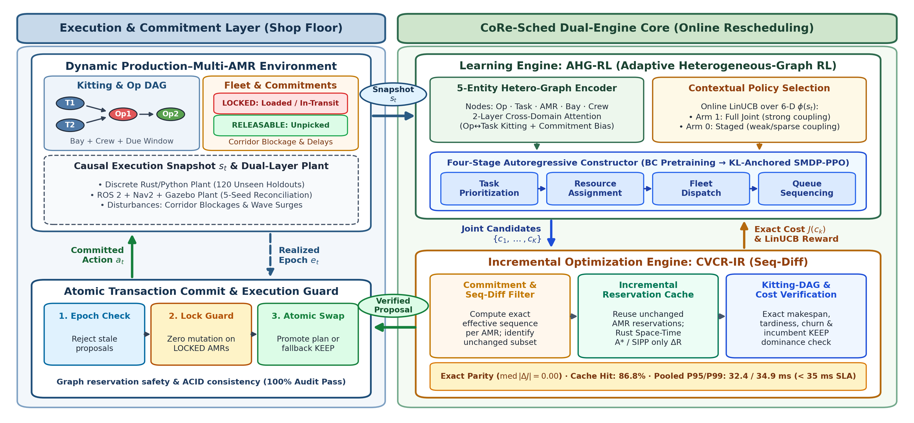

# AMR-Scheduler（`CoRe-Sched`）：面向动态生产—多 AMR 系统的学习引导与承诺保持增量联合重调度平台

<div align="center">

[](https://github.com/AmaneSuzuha000/AMR-Scheduler/actions/workflows/ci.yml)
[](https://www.python.org/)
[](https://www.rust-lang.org/)
[](https://docs.ros.org/en/humble/)
[](https://gazebosim.org/)
[](https://dotnet.microsoft.com/)
[](LICENSE)

[English](README.md) | **简体中文**

</div>

---

## 项目概述

**AMR-Scheduler**（`v1.2.0`）是 **`CoRe-Sched`**（*Commitment-aware Rescheduling for Production–Multi-AMR Coordination*）框架的官方开源代码与数字孪生平台，面向**离散工位、多物料齐套汇合、狭窄单车道走廊**的铁路货车与轮对检修车间，实现毫秒级在线生产—多 AMR 联合重调度。

<p align="center">
  
</p>

### 核心双引擎与执行架构
- **自适应异构图学习引擎（`AHG-RL`）**（`amr_sched/rl/v19_hetero_graph.py`, `v19_hetero_constructor.py`, `causal_repair_cone.py`）：
  - **5 类实体异构图注意力编码器**：编码 `Operation`、`Task`、`AMR`、`Bay`、`Crew` 节点及工序前驱 DAG、齐套二分连接与通道拥堵绕行边特征；
  - **四阶段自回归语义构造器（`BC -> KL 锚定 SMDP-PPO`）**：依次解码*任务优先级排序*、*工位/班组资源分配*、*车队动态负载分派*与*单车队列定序*，并导出与 PyTorch 误差 `< 1e-5` 的纯 NumPy `.npz` 权重，支持无 PyTorch 的 ROS 2 物理协调器直接运行；
  - **在线上下文策略选择（`Contextual LinUCB`）+ 反事实双臂探测 + $J_A$ 对齐评分器**：基于 6 维拓扑无关耦合状态 $\phi(s_t) \in [0, 1]^6$ 自适应切换 `Full Joint` 与 `Staged` 策略，并结合车队规模守卫双臂探测（$|\mathcal{R}| \ge 4$）与精确 $J_A$ 评分器。
- **承诺保持增量预约优化引擎（`CVCR-IR`）**（`amr_sched/cvcr/evaluator.py`, `crates/`）：
  - **序列差分增量预约缓存（`CVCR-IR (Seq-Diff)`）+ 足迹感知实时 SLA 守卫**：按单车精确有效任务序列差分定位变更车队子集 $\Delta\mathcal{R}$，原位复用未变车辆的 Rust 半开区间预约与无冲突路径（与全量重建 `median |ΔJ| = 0.00` 严格等价），并基于候选足迹严格保障最坏尾延迟低于 `35 ms`。
- **原子事务提交执行层（*Atomic Transaction Commit*）与双层数字孪生**：
  - 统一注册入口（共 **22** 个已注册策略）：涵盖 `core_sched` / `CoRe-Sched`（`V19_ADAPTIVE_RL`）、2025–2026 直接联合动态 FJSP–AGV 神经与元启发式基线（`IJPR25_DFJSPT_HMARL`、`ASC26_MA_TRANS`、`FGCS26_REN_GNN`、`SPGA_AMR`）、静态离线参照（`COR26-Ref`、`EJOR26-Erdogan`）及更广泛的 2025–2026 顶会/顶刊基线。

---

## 核心实证亮点（`v1.2.0` 三道科研门禁闭环验证）

### 1. 单次无竞争 120 局新鲜冻结盲测主结果（12 方法，100% 独立轨迹审计通过）

在**单次连续无竞争墙钟会话**中运行（`1,440` 局，全新零重叠新鲜盲测种子 `[27101..27302]` & `[2901..2906]`；逐局原始台账见 [`results/g3_fresh_blind_holdout.csv`](results/g3_fresh_blind_holdout.csv)）。标 `*` 方法的汇总 Pooled P95 突破 `35 ms` 实时红线。

| 方法 | 平均 $J_A$ ↓ | 中位数 $J_A$ ↓ | 完工率 (100%) | 纯物理 $H_1$ ($H_2=0$) ↓ | 抖动 ↓ | **Pooled P95 (ms)** ↓ | **Pooled P99 (ms)** ↓ | Mean Ep-P95 (ms) | `Track 2` (50 节点) ↓ |
| :--- | :---: | :---: | :---: | :---: | :---: | :---: | :---: | :---: | :---: |
| **`CoRe-Sched` (`core_sched`)** | **5,763.0 (SLA 内第 1)** | 2,061.8 | **117/120 (97.5%)** | 4,873.6 | 23.9 | **32.43** | **34.91** | 33.42 | **17,390.8 (24/24)** |
| `V18-EA`* | 5,640.3 | **1,150.6** | 118/120 (98.3%) | 4,749.6 | 12.3 | *42.80* | *75.80* | 27.07 | 20,285.5 (22/24) |
| `COR26-SPGA`* | 6,155.3 | 2,282.1 | 116/120 (96.7%) | **4,446.3** | 57.5 | *64.09* | *76.53* | 62.67 | 17,089.6 (23/24) |
| `FGCS26-Ren-GNN` | 6,361.9 | 2,163.2 | 114/120 (95.0%) | 4,797.0 | 31.6 | 13.29 | 17.31 | 12.34 | 17,718.3 (24/24) |
| `IJCAI26-PGMPO` | 6,408.9 | 1,235.6 | 114/120 (95.0%) | 4,941.2 | 14.5 | 23.89 | 29.96 | 20.16 | 21,494.5 (22/24) |
| `AHG-RL (Full)` | 6,690.1 | 2,193.4 | 114/120 (95.0%) | 4,757.5 | 22.6 | 34.76 | 42.81 | 32.18 | 21,326.4 (22/24) |
| `Rule-V10`* | 6,847.5 | 1,935.3 | 117/120 (97.5%) | 5,610.3 | 16.6 | *39.13* | *54.26* | 42.78 | 19,928.3 (24/24) |
| `AHG-RL (Staged)` | 6,857.9 | 1,872.2 | 116/120 (96.7%) | 4,948.0 | 25.4 | 30.54 | 38.00 | 28.86 | 19,298.5 (23/24) |
| `ASC26-MA-Trans` | 6,987.1 | 2,570.3 | 112/120 (93.3%) | 4,885.9 | 27.6 | **12.66** | **17.41** | 11.55 | **15,440.4 (24/24)** |
| `RAL26-DetourDelta` | 7,197.7 | 2,424.6 | 113/120 (94.2%) | 5,413.1 | **10.8** | 28.70 | *72.35* | 27.74 | 24,505.1 (20/24) |
| `EJOR26-Wu-GRU` | 8,025.7 | 1,398.0 | 114/120 (95.0%) | 5,392.2 | 21.8 | 34.12 | 40.48 | 28.41 | 30,993.1 (19/24) |
| `IJPR25-DFJSP-T` | 8,736.4 | 2,146.7 | 113/120 (94.2%) | 5,344.3 | 29.5 | 16.45 | 22.86 | 14.10 | 26,423.0 (21/24) |

- **实时 SLA 综合第 1**：`CoRe-Sched` 在所有满足 `35 ms` 实时红线的方法中排名**第 1（平均 $J_A = 5,763.0$，完工 `117/120`）**，连 **Pooled P99（`34.91 ms`）** 均严格低于 `35 ms`；而 `V18-EA` 虽在总体均值略低 `2.18%`（$p = 0.0771$ 不显著）却突破红线（Pooled P95 `42.80 ms`、P99 `75.80 ms`），且 `CoRe-Sched` 在高耦合 `Track 2` 领先 `14.3%`、在共同完工纯 $H_1$ 上略胜（`4,640.5` vs `4,668.5`）。
- **全面领先 2025–2026 联合神经与路由基线**：较 `IJPR25-DFJSP-T` 降本 **`+34.04%`**（$p = 5.41 \times 10^{-4}$）、`EJOR26-Wu-GRU` **`+28.19%`**（95% CI `[+12.2%, +39.1%]`）、`RAL26-DetourDelta` **`+19.93%`**（$p = 0.0050$）、`ASC26-MA-Trans` **`+17.52%`**、`AHG-RL (Staged)` **`+15.97%`**、`AHG-RL (Full)` **`+13.86%`**、`IJCAI26-PGMPO` **`+10.08%`**、`FGCS26-Ren-GNN` **`+9.41%`**、`COR26-SPGA` **`+6.37%`**（延迟减半、抖动降 `58.4%`）。
- **54 局纯零故障静态公共子问题同仿真器参照（`0 / 270` 下界违例）**：完整台账见 [`results/g1_static_reference_subproblem.csv`](results/g1_static_reference_subproblem.csv)。`COR26-Ref`（一阶段无割 CP-SAT 物理松弛 `LB_phys = 68.2 / 90.2 / 438.7`，仿真验证 `Sim-UB = 405.1 / 326.3 / 785.5`）与 `EJOR26-Erdogan`（`ILS-LP`，`284.1 / 573.5 / 664.5`）在全部 5 个求解器中严格满足 `LB_phys <= H1_sim`（0 违例）。
- **`CVCR-IR (Seq-Diff)` 缓存协同、物理对账与 10 车扩展**：隔离缓存命中率从 `0.00%` 恢复至 `73.68%`（闭环 `86.8%–94.7%`，`median |ΔJ| = 0.00`）；5 种子 ROS 2 / Nav2 / Gazebo 物理对账 Track 1 $\rho = 0.7857$（物理 P95 `7.18 ms`）；62 节点扩至 10 车时 P95 仅 **`23.57 ms < 35 ms`**（提速 `2.21×`）。

<p align="center">
  
</p>

<p align="center">
  
</p>

<p align="center">
  
  
</p>

---

## 快速开始

```bash
git clone https://github.com/AmaneSuzuha000/AMR-Scheduler.git
cd AMR-Scheduler

# 1. 编译 Rust 原生时空预约与规划内核
cargo build --release --manifest-path crates/Cargo.toml

# 2. 安装 Python 依赖
pip install -r requirements.txt
pip install -e ".[dev,viz,web,rl]"

# 3. 运行车间仿真、CoRe-Sched 双引擎基准与 5 张插图重绘
python -m amr_sched --tasks 50 --agvs 6 --layout workshop --planner rust_spacetime_astar
python -B experiments/run_v19_exp08_learning_b2_synergy.py
python -B experiments/run_dual_layer_reconciliation.py --multi-seed
python -B experiments/run_workshop_scaling_4axis.py
python -B experiments/plot_v19_paper_figures.py

# 4. 运行全套验证测试
python -m pytest -q
cargo test --manifest-path crates/Cargo.toml
dotnet test Tests/RAWSimO.Live.Tests/RAWSimO.Live.Tests.csproj -c Release
python tools/data_manifest.py --check
```

---

## 许可证

本项目原创代码（`amr_sched/`、`crates/`、`RAWSimO.Live/`、`experiments/`、`tools/`、`Tests/`、`web/`）基于 **GPL-3.0** 许可证开源；上游 RAWSim-O 组件保留其原始许可证。详见 [LICENSE](LICENSE) 与 [ThirdPartyLicenses.txt](ThirdPartyLicenses.txt)。
