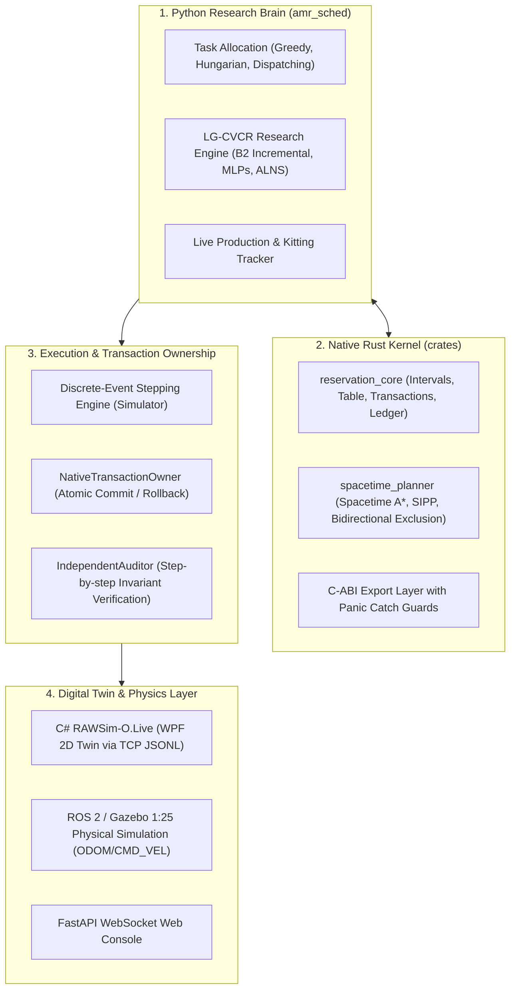

# AMR-Scheduler: System Architecture & Design Specification

## 1. System Overview

**AMR-Scheduler** is a hybrid Python/Rust/C# research platform designed for multi-robot material delivery scheduling and coordination in discrete-workstation, batch-material, narrow-aisle railway freight car maintenance workshops.

---

## 2. Layer Architecture

### Layer 1: Python Decision Brain (`amr_sched/`)
- **Task Allocation**: Dispatches pending material demands to idle or prospective AMRs based on network travel times, station affinities, and deadlines.
- **LG-CVCR Decision Engine**:
  - `NativeSnapshotCapture`: Extracts an authoritative, point-in-time immutable snapshot of AMRs, active tasks, committed routes, and production operations. Supports `hide_future_releases=True` to prevent future information leakage in online settings.
  - `CVCREvaluator`: Factorial incremental evaluator (`A1` full replan, `B1` path preserve, `B2` persistent reservation cache with in-place release/restore).
  - `LGCVCRPolicy`: Proposes legal task reallocation, bay/crew diversions, or fleet admission gates strictly within a $150\,\text{ms}$ computational budget.

### Layer 2: Native Rust Kernel (`crates/`)
- **`reservation_core`**:
  - Implements interval algebra (`Interval::try_new(start, end)`), node/edge interval tree locks, and bidirectional corridor exclusion.
  - Exposes an ACID `ReservationTransaction` staging engine and an `ExecutionCommitmentLedger` for non-preemptible execution hops.
- **`spacetime_planner`**:
  - High-speed Spacetime A* ($41\,\mu\text{s}/\text{call}$) and Safe Interval Path Planning (SIPP, $36\,\mu\text{s}/\text{call}$) operating on 64-bit packed states.
- **Panic Boundary Guard**:
  - All `extern "C"` FFI entry points are guarded by `std::panic::catch_unwind(AssertUnwindSafe(|| ...))` to prevent any Rust panic from crossing the C-ABI into the host Python/C# runtimes.

### Layer 3: Simulation & Execution Ownership (`Simulator`, `Transaction`, `Auditor`)
- **Single-Writer Execution Owner**: Only `Simulator` mutates authoritative physical world state.
- **`NativeTransactionOwner`**:
  - Validates candidate proposals against snapshot digest, tick monotonicity, irrevocable task assignments (carrying cargo), active node reservations, and valid graph edges.
  - Applies atomic commits without partial state mutations.
- **`IndependentAuditor`**:
  - Trajectory audit inspects `_trajectory` step-by-step, verifying:
    1. Node occupancy $\le \text{capacity}$ at every tick.
    2. Edge traversal along valid directed network edges.
    3. Monotonic task timeline: `release <= assign <= pickup <= complete`.
    4. Kitting precedence: kitting tasks complete before dependent operations start.
    5. Station bay, crew, and tool exclusive occupancy intervals never overlap.

### Layer 4: Digital Twin & Physics Presentation Layer
- **RAWSim-O.Live**: High-performance C# WPF visualizer connecting via loopback socket streaming JSONL frame records.
- **Gazebo / ROS 2**: 1:25 scale physical verification environment with differential-drive robot kinematics, laser scan registration, and collision geometry.

---

## 3. Cross-Language Interoperability Architecture

| Interop Channel | Implementation | Rationale |
| :--- | :--- | :--- |
| **Python $\leftrightarrow$ Rust** | C-ABI `cdylib` loaded via `ctypes` | Zero-GC overhead; cross-interpreter compatibility (Python 3.10–3.14); shared dynamic library between Python and C#. |
| **C# $\leftrightarrow$ Rust** | P/Invoke over standard `cdylib` exports | Direct native marshalling without COM or interprocess overhead. |
| **Python $\leftrightarrow$ C# Live Twin** | Loopback TCP socket streaming JSONL | Non-blocking telemetry decoupling; allows independent GUI crashes without interrupting scheduling state. |
| **Python $\leftrightarrow$ ROS 2 / Gazebo** | Socket bridge / ROS 2 node (`rclpy`) | Standard robotics ecosystem interface for wheel odometry and velocity commands. |

---

## 4. Safety & Physical Boundary Protocol

1. **Hardware Motion Isolation**:
   - `receipt.physical_authorization` is **strictly set to `False`** in all software simulation and algorithmic optimization loops.
   - Real hardware actuation requires a separate physical gatekeeper with hardware E-stop, localized odometry freshness verification, and active motion leases.
2. **Crash & Infeasible State Handling**:
   - If a proposed reschedule is infeasible, `NativeTransactionOwner` rejects it with descriptive reason codes (e.g. `VIOLATION_IRREVOCABLE_TASK_MUTATION`), falling back to the existing valid execution schedule.
