# AMR-Scheduler: System Architecture & Design Specification

## 1. System Overview

**AMR-Scheduler** (`v1.4.0`) is a hybrid Python / Rust / C# / ROS 2 research infrastructure and digital twin platform serving two complementary tracks over shared layouts, spatiotemporal kernels, and independent verification harnesses: **Track A** (Layers 2–3, active focus on congestion-aware routing, execution-aware STP, and continuous physical motion safety) and **Track B** (Layers 4–5, frozen validated `CoRe-Sched` dynamic production–multi-AMR rescheduling suite).

```mermaid
flowchart TD
    subgraph Brain["1. Python Decision & Learning Layer (amr_sched)"]
        V19["Hetero-GNN RL"]
        CVCR["B2 Evaluator"]
        P4["P4 Belief Core"]
        Baselines["2026 Baselines"]
    end

    subgraph Kernel["2. Native Rust Spatiotemporal Kernel (crates)"]
        ResCore["Interval Core"]
        Planner["Rust A* / SIPP"]
        FFI["C-ABI FFI"]
    end

    subgraph Execution["3. Execution Ownership & Independent Audit"]
        TxOwner["Tx Owner"]
        Sim["Simulator"]
        Auditor["Traj Auditor"]
    end

    subgraph Twin["4. Digital Twin & Physical HIL Layer"]
        RAWSim["RAWSim-O.Live"]
        Gazebo["ROS 2 + Gazebo"]
        WebDash["Web Console"]
    end

    Brain <-->|Zero-Copy FFI| Kernel
    Brain --> TxOwner
    TxOwner --> Sim
    Sim --> Auditor
    Sim -.->|TCP JSONL| RAWSim
    Sim -.->|ROS 2 / CAN| Gazebo
    Sim -.->|WebSocket| WebDash
```

---

## 2. Layer Architecture

### Layer 1: Python Decision & Learning Brain (`amr_sched/`)
- **Allocation & Dispatch (`amr_sched/allocation/`)**: Supports greedy, Hungarian optimal matching, composite dispatching rules (`FIFO`, `EDD`, `SPT`, `PRIORITY`, `CR`), and time-windowed task assignment.
- **Execution-Aware CVCR & Heterogeneous-Graph Joint Construction Stack (`amr_sched/cvcr/`, `amr_sched/rl/`)**:
  - `NativeSnapshotCapture` (`snapshot.py`): Captures immutable point-in-time world state with `hide_future_releases=True` to guarantee zero future leakage.
  - `classify_commitments` (`commitment.py`): Partitions tasks into `FROZEN_COMMITMENT` (picked/loading/unloading/in-transit) vs legally re-assignable/re-routable tasks.
  - `CVCREvaluator` (`evaluator.py`): Evaluates candidate joint decisions incrementally (`A1` full replan, `B1` path preserve, `B2` persistent reservation cache with in-place release/restore) within strict compute budgets.
  - `V17WindowProtectionPolicy` (`v17_window_protection.py`): Unifies a topology-free causal mode router (`V15_SOFT`, `V7_CALM`, `V10_GUIDED`), a 50-D Set-Attention pairwise window payoff ranker, and a Keep-Zero Conservative Regret Restraint gate.
  - `P4` Belief & Choke Arbitration (`p4_belief_choke.py`) + Event-SMDP Feedback (`v17_event_smdp.py`): Handles recurring blockage estimation, directional single-lane bridge tokens, safe-haven holds, and execution-drift alarms (`physical_bridge.py`).
  - **Packaged Inference Weights (`amr_sched/checkpoints/`)**: Compact pure-NumPy `.npz` checkpoints (`resolve_default_checkpoint` in `amr_sched/cvcr/checkpoints.py`) enable self-contained inference without PyTorch at runtime.
- **RL & 2026 Venue Baselines (`amr_sched/rl/`, `amr_sched/baselines/`)**:
  - `AMRReschedulingEnv` provides Gymnasium-compatible SMDP observations (`V7`, `V9`, `V12`, `V16`) and physics-grounded action masks.
  - `baselines_2026.py`, `top_venue_baselines.py`, and `spga_cor2026.py` implement comparable causal proposers strictly conforming to the `CandidateProposal` + ACID `NativeTransactionOwner` contract.

### Layer 2: Native Rust Kernel (`crates/`)
- **`reservation_core`**: Integer half-open `[start, end)` interval algebra, indexed array tables for zero-copy batch queries, bidirectional corridor mutual exclusion, ACID `ReservationTransaction` staging, and `ExecutionCommitmentLedger`.
- **`spacetime_planner`**: Packed `u64` Spacetime A\* ($41\,\mu\text{s}$ mean call) and batch parallel Safe Interval Path Planning ($36\,\mu\text{s}$ mean call).
- **Panic Boundary Guard**: Every `extern "C"` FFI entry point uses `ffi_guard!` (`std::panic::catch_unwind`) so Rust panics are contained cleanly and never unwind across C-ABI boundaries.

### Layer 3: Single-Writer Execution & Independent Audit
- **`Simulator` (`amr_sched/simulation.py`)**: Sole authoritative writer of robot poses, task lifecycles, and reservation tables, enforcing mid-edge (`_transit`) immutability and virtual/real execution clocks.
- **`NativeTransactionOwner` (`amr_sched/cvcr/transaction.py`)**: Atomically validates snapshot digest consistency, tick monotonicity, irrevocable task assignments, mid-edge live repairs, and edge feasibility before mutating simulator state.
- **`IndependentAuditor` (`amr_sched/cvcr/auditor.py`)**: Independently audits recorded trajectories for node capacity, edge validity, monotonic task timelines (`release <= assign <= pickup <= complete`), kitting precedence, and exclusive workstation bay/crew/tool intervals.

### Layer 4: Digital Twin, ROS 2 / Nav2 & Physical Bridge (`RAWSimO.Live/`, `tools/live_bridge/`, `tools/ros2/`, `web/`)
- **RAWSim-O.Live**: `.NET 6` TCP JSONL consumer and topology tracker driving the C# WPF 2D visualization (`PROTOCOLS.md`).
- **ROS 2 / Nav2 / AgileX SCOUT Mini**: Translates scheduled corridors into Nav2 parameters, RViz overlays (`amr_v15_digital_twin.rviz`), Costmap corridor projections (`costmap_corridor_projector.py`), and SCOUT Mini CAN 2.0B (`0x421`/`0x211`/`0x221`) commands with virtual `vcan0` loopback verification (`vcan_gazebo_bridge.py`).

---

## 3. Cross-Language Interoperability Architecture

| Interop Channel | Implementation | Rationale |
| :--- | :--- | :--- |
| **Python $\leftrightarrow$ Rust** | C-ABI `cdylib` loaded via `ctypes` | Zero-GC overhead; zero-copy array pointers; compatible across Python 3.10–3.14 and C#. |
| **C# $\leftrightarrow$ Rust** | P/Invoke over shared `cdylib` exports | Direct native marshalling without COM or IPC copies. |
| **Python $\leftrightarrow$ C# Live Twin** | Loopback TCP socket streaming JSONL | Non-blocking telemetry decoupling (`PROTOCOLS.md`). |
| **Python $\leftrightarrow$ ROS 2 / SCOUT** | `rclpy` bridge, Nav2 corridor projector & SocketCAN / `vcan0` | Standard industrial robotics stack for odometry, costmap locking, and E-stop safety. |

---

## 4. Safety & Physical Boundary Protocol

1. **Hardware Motion Isolation**:
   - `receipt.physical_authorization` remains `False` in all software optimization loops.
   - Real or Gazebo chassis actuation flows through hardware/C++ watchdogs (`250 ms` SCOUT CAN timeout, velocity clamping `<= 1.5 m/s`, hard E-stop interlock, odometry freshness gates) and `amr_gazebo_guard`.
2. **Rejection & Rollback Guarantee**:
   - Any candidate violating commitment immutability (`VIOLATION_IRREVOCABLE_TASK_MUTATION`), mid-edge safety (`VIOLATION_LIVE_REPAIR_IN_TRANSIT`), or stale state is atomically rejected while preserving the prior conflict-free schedule.

---

## 5. Five-Layer Dual-Track Research Architecture & Multi-Fidelity Roadmap

| Stack Layer | Responsibility | Key Modules & Algorithms | Current Status |
| :--- | :--- | :--- | :--- |
| **Layer 5 · Joint Production–Resource Opt** | Process–bay–crew–transport coupling | `V18`, `V19` (`AHG-RL`), `V20_1`, `RGRO` | Frozen validated baseline (Track B) |
| **Layer 4 · Dynamic Task Scheduling** | Task assignment, commitment preservation, rescheduling | `CVCR-IR`, allocators, dispatching baselines | Frozen validated baseline (Track B) |
| **Layer 3 · Multi-Robot Traffic Coordination** | Spatiotemporal reservation, congestion field, right-of-way | `CPS-A*`, `EALR`, `U1a_EdgeSpan_Fix`, `ExecutionAuditSim` | Active focus (Track A) |
| **Layer 2 · Local Physical Motion Planning** | Kinodynamic primitives, swept capsule safety, local yield | `R1_Robust`, `motion_primitives`, `BrakingInvariantShield` | Active focus (Track A) |
| **Layer 1 · Physical Execution & Sensing** | Unicycle / chassis control, localization, CAN/ROS 2 | ROS 2 / Nav2, Gazebo, AgileX SCOUT Mini | Digital twin & HIL verified |

### Platform Assets Built Through Empirical Falsification
- **Continuous Unicycle World & Swept Safety (`metric_world.py`, `geometry_and_shield.py`)**: Originated during `RG-PPO` and `Robust RAMP` studies; eliminates longitudinal single-disc underestimates (`0.10–0.20 m`) and eliminates all `12,247` peer-collision substep ticks across the `36`-episode observed confirmation split `7001–7006` (with blind seeds `8001–8010` kept untouched).
- **Bitwise Counterfactual Evaluation Harness (`clone_snapshot()`, `audit_env.py`)**: Quantifies causal marginal headroom (`<= +0.85%` at `RAMP`, `+0.43%` at `STCP-RL`, `-10.53%` at finite-pool `EA-STP`) without training speculation.
- **Multi-Tick Edge Span Fix (`U1a_EdgeSpan_Fix`)**: Resolves unreserved mid-corridor traversal spans (`18/18` DEV ZeroCol, `+6.00%` completion at `0.376 ms/plan`).

### Multi-Fidelity Foundation Compatibility Audit & Interface (`v1.4.1`)
`experiments/foundation_audit/` implements a read-only **Unified Execution Interface (`execution_interface.py`)** pairing `DiscreteBackendAdapter` (`amr_sched.simulation.Simulator`) and `ContinuousBackendAdapter` (`U1a_EdgeSpan_Fix` + `R1_Robust`) over shared `UnifiedTaskSpec`/`UnifiedRobotSpec` DTOs without touching Track A or Track B cores:
- **Reservation Isolation (`F0`)**: Verified `0` occurrences of `arr_i - 1` or `expand_planned_to_step_positions` in `amr_sched/`, `crates/`, or `tools/`; confirmed full `[depart, arrive)` exclusion across `20–30 m` Workshop corridors.
- **Cross-Fidelity Alignment & Replay (`F2–F4`)**: Demonstrated `100%` (`38/38`) ZeroCol under `ContinuousBackendAdapter` across `F2` paired benchmarks and `28` Cohort A replays (`7` Track B policies on `track1 2901–2902` and `topo4 27101–27102`), while isolating non-reversing (`v >= 0`) bay-spur deadlocks and non-Euclidean graph length distortion (`topo4`) as the root causes of cross-fidelity rank inversions (Makespan $\rho = 0.25$ on classical allocators; Cohort A Tardiness $\rho = 0.2965$ on `track1` and `0.2857` on `topo4`).
- **Non-RL ETA Calibration Probe (`F5`)**: Out-of-sample calibration (`seed 6001 -> 6002`) reduced Leg ETA MAE by `-46.19%` (Ridge) and Makespan MAE by `-12.15%`, proving scalar speed tuning alone cannot fix structural bay-spur ordering inversions.
