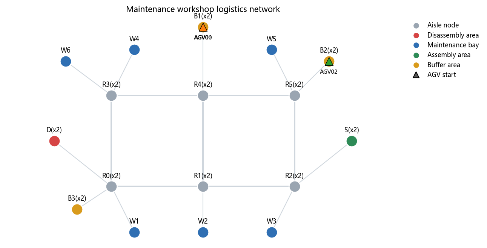
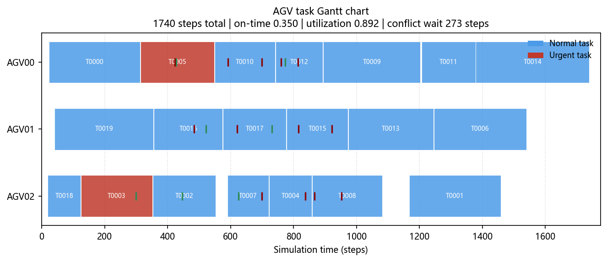
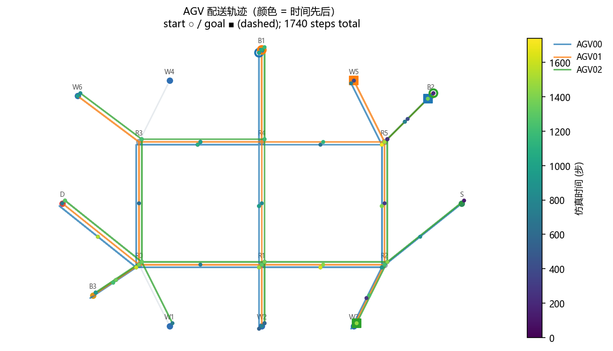
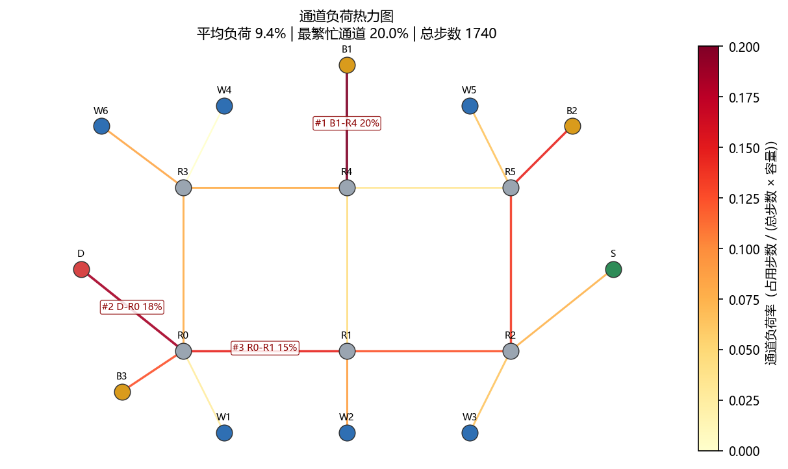
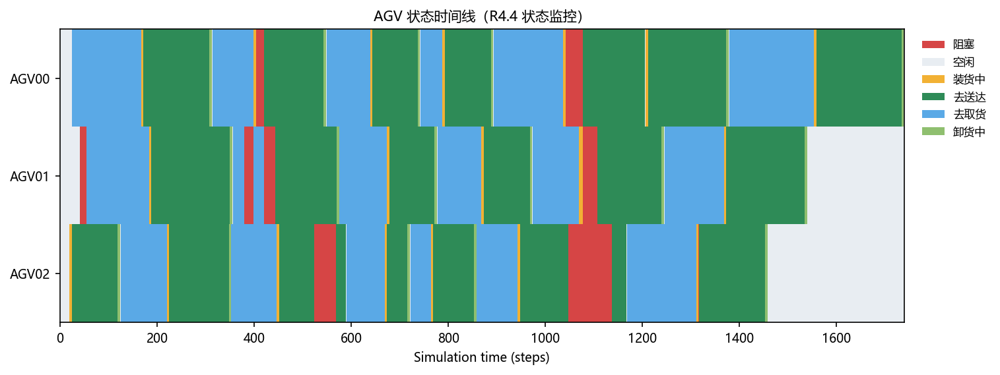
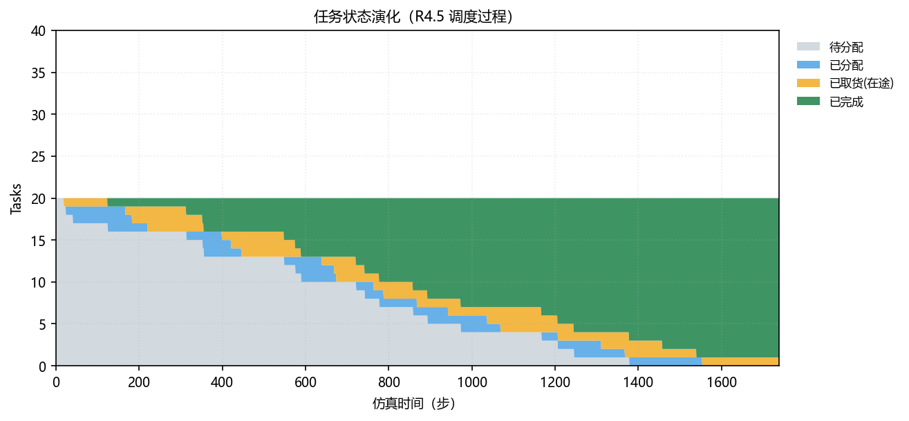

# Scheduling process report

Instance: 20 tasks / 3 AGVs / seed=0 / planner=spacetime_astar / reschedule=none

## The four acceptance metrics

| Metric | Value |
|---|---|
| Completion time | 1739.0 s |
| On-time rate | 0.350 |
| AGV utilization | 0.892 |
| Conflict wait | 273 steps |

## Urgent tasks and execution quality

| Item | Value |
|---|---|
| Tasks completed | 20 / 20 |
| Urgent on-time rate | 0.500 |
| Mean urgent response | 148.5 steps |
| Preemptions | 0 |
| Planning retries | 0 |
| Hard failures | 0 |
| Collision events | 0 |

## Busiest aisles (top 5)

| Aisle | Load | Capacity | Occupied steps |
|---|---|---|---|
| B1 - R4 | 20.0% | 1 | 348 |
| D - R0 | 18.4% | 1 | 320 |
| R0 - R1 | 14.6% | 2 | 507 |
| B2 - R5 | 14.5% | 1 | 252 |
| R2 - R5 | 13.4% | 2 | 468 |

## Figures

## Process monitoring

Static figures only show the outcome. The next two show the **process**: what
state each vehicle is in at every moment, and how tasks migrate between states.

Animation: [animation.gif](animation.gif)